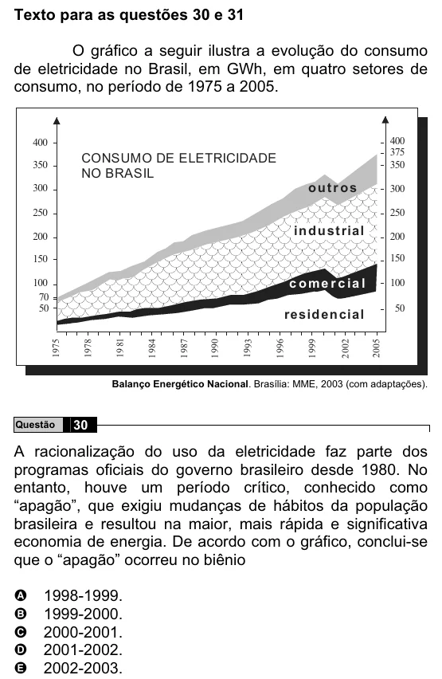

Texto extraído (pode conter ruído)

Texto para as questões 30 e 31  
O gráfico a seguir ilustra a evolução do consumo  
de eletricidade no Brasil, em GWh, em quatro setores de  
consumo, no período de 1975 a 2005.  
400  
400  
375  
CONSUMO DE ELETRICIDADE  
350  
350  
NO BRASIL  
outr os  
300  
300  
250  
250  
in d u st rial  
200  
200  
150  
150  
c o m e r c ia l  
100  
100  
70  
50  
resid en cial  
50  
1975  
1978  
19 81  
1 984  
1 987  
1 990  
1993  
1 996  
1 999  
2 002  
2005  
Balanço Energético Nacional. Brasília: MME, 2003 (com adaptações).  
Questão  
30  
A racionalização do uso da eletricidade faz parte dos  
programas oficiais do governo brasileiro desde 1980. No  
entanto, houve um período crítico, conhecido como  
“apagão”, que exigiu mudanças de hábitos da população  
brasileira e resultou na maior, mais rápida e significativa  
economia de energia. De acordo com o gráfico, conclui-se  
que o “apagão” ocorreu no biênio  
A  
1998-1999.  
1999-2000.  
B  
2000-2001.  
C  
D  
2001-2002.  
2002-2003.  
E

