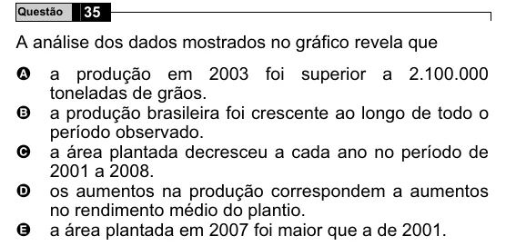

Texto extraído (pode conter ruído)

Questão  
35  
A análise dos dados mostrados no gráfico revela que  
A  
a produção em 2003 foi superior a 2.100.000  
toneladas de grãos.  
B  
a produção brasileira foi crescente ao longo de todo o  
período observado.  
C  
a área plantada decresceu a cada ano no período de  
2001 a 2008.  
os aumentos na produção correspondem a aumentos  
D  
no rendimento médio do plantio.  
a área plantada em 2007 foi maior que a de 2001.  
E

