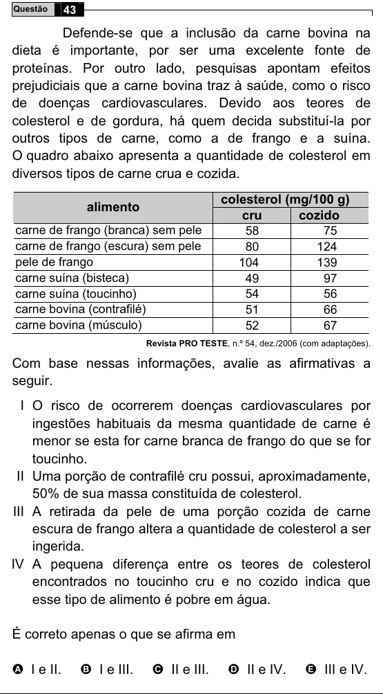

Texto extraído (pode conter ruído)

Questão  
43  
Defende-se que a inclusão da carne bovina na  
dieta é importante, por ser uma excelente fonte de  
proteínas. Por outro lado, pesquisas apontam efeitos  
prejudiciais que a carne bovina traz à saúde, como o risco  
de doenças cardiovasculares. Devido aos teores de  
colesterol e de gordura, há quem decida substituí-la por  
outros tipos de carne, como a de frango e a suína.  
O quadro abaixo apresenta a quantidade de colesterol em  
diversos tipos de carne crua e cozida.  
colesterol (mg/100 g)  
alimento  
cru  
cozido  
carne de frango (branca) sem pele  
58  
75  
carne de frango (escura) sem pele  
80  
124  
pele de frango  
104  
139  
carne suína (bisteca)  
49  
97  
carne suína (toucinho)  
54  
56  
carne bovina (contrafilé)  
51  
66  
carne bovina (músculo)  
52  
67  
Revista PRO TESTE, n.º 54, dez./2006 (com adaptações).  
Com base nessas informações, avalie as afirmativas a  
seguir.  
I O risco de ocorrerem doenças cardiovasculares por  
ingestões habituais da mesma quantidade de carne é  
menor se esta for carne branca de frango do que se for  
toucinho.  
II Uma porção de contrafilé cru possui, aproximadamente,  
50% de sua massa constituída de colesterol.  
III A retirada da pele de uma porção cozida de carne  
escura de frango altera a quantidade de colesterol a ser  
ingerida.  
IV A pequena diferença entre os teores de colesterol  
encontrados no toucinho cru e no cozido indica que  
esse tipo de alimento é pobre em água.  
É correto apenas o que se afirma em  
A I e II.  
B I e III.  
C II e III.  
D II e IV.  
E III e IV.

