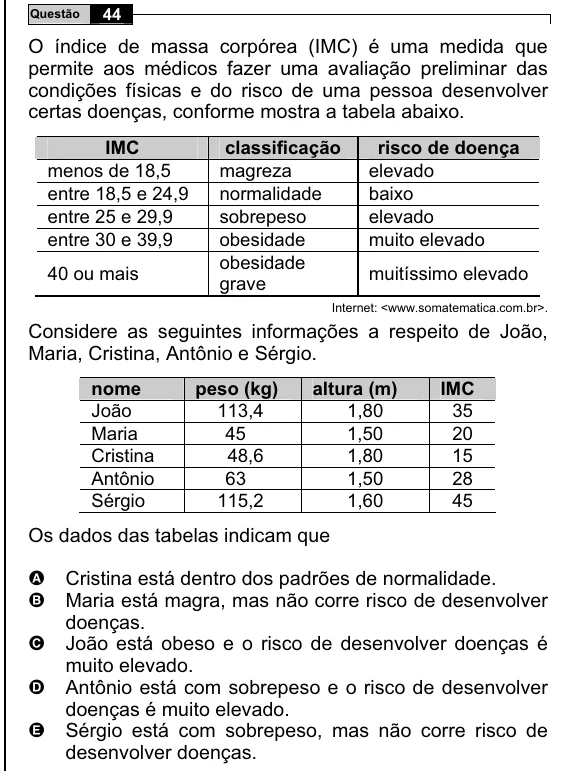

Texto extraído (pode conter ruído)

44  
Questão  
O índice de massa corpórea (IMC) é uma medida que  
permite aos médicos fazer uma avaliação preliminar das  
condições físicas e do risco de uma pessoa desenvolver  
certas doenças, conforme mostra a tabela abaixo.  
IMC  
classificação  
risco de doença  
menos de 18,5  
magreza  
elevado  
entre 18,5 e 24,9  
normalidade  
baixo  
entre 25 e 29,9  
sobrepeso  
elevado  
entre 30 e 39,9  
obesidade  
muito elevado  
obesidade  
40 ou mais  
muitíssimo elevado  
grave  
Internet: <www.somatematica.com.br>.  
Considere as seguintes informações a respeito de João,  
Maria, Cristina, Antônio e Sérgio.  
nome  
peso (kg)  
altura (m)  
IMC  
João  
113,4  
1,80  
35  
Maria  
45  
1,50  
20  
Cristina  
48,6  
1,80  
15  
Antônio  
63  
1,50  
28  
Sérgio  
115,2  
1,60  
45  
Os dados das tabelas indicam que  
Cristina está dentro dos padrões de normalidade.  
A  
B  
Maria está magra, mas não corre risco de desenvolver  
doenças.  
C  
João está obeso e o risco de desenvolver doenças é  
muito elevado.  
D  
Antônio está com sobrepeso e o risco de desenvolver  
doenças é muito elevado.  
E  
Sérgio está com sobrepeso, mas não corre risco de  
desenvolver doenças.

