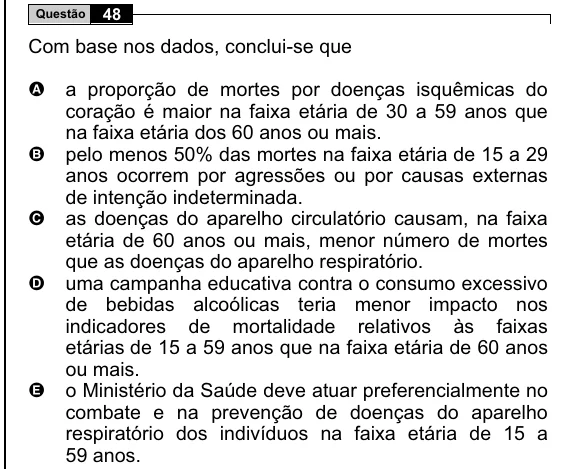

Texto extraído (pode conter ruído)

48  
Questão  
Com base nos dados, conclui-se que  
a proporção de mortes por doenças isquêmicas do  
A  
coração é maior na faixa etária de 30 a 59 anos que  
na faixa etária dos 60 anos ou mais.  
B  
pelo menos 50% das mortes na faixa etária de 15 a 29  
anos ocorrem por agressões ou por causas externas  
de intenção indeterminada.  
C  
as doenças do aparelho circulatório causam, na faixa  
etária de 60 anos ou mais, menor número de mortes  
que as doenças do aparelho respiratório.  
uma campanha educativa contra o consumo excessivo  
D  
de bebidas alcoólicas teria menor impacto nos  
indicadores de mortalidade relativos às faixas  
etárias de 15 a 59 anos que na faixa etária de 60 anos  
ou mais.  
o Ministério da Saúde deve atuar preferencialmente no  
E  
combate e na prevenção de doenças do aparelho  
respiratório dos indivíduos na faixa etária de 15 a  
59 anos.

