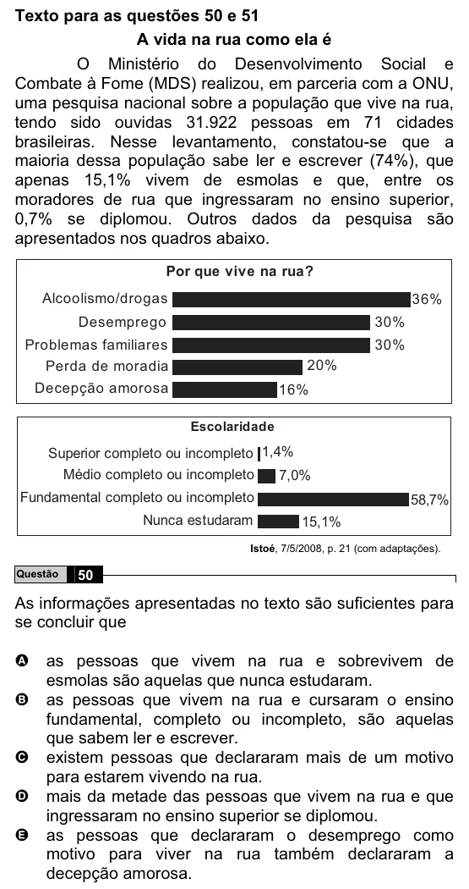

Texto extraído (pode conter ruído)

Texto para as questões 50 e 51  
A vida na rua como ela é  
O Ministério do Desenvolvimento Social e  
Combate à Fome (MDS) realizou, em parceria com a ONU,  
uma pesquisa nacional sobre a população que vive na rua,  
tendo sido ouvidas 31.922 pessoas em 71 cidades  
brasileiras. Nesse levantamento, constatou-se que a  
maioria dessa população sabe ler e escrever (74%), que  
apenas 15,1% vivem de esmolas e que, entre os  
moradores de rua que ingressaram no ensino superior,  
0,7% se diplomou. Outros dados da pesquisa são  
apresentados nos quadros abaixo.  
Por que vive na rua?  
Alcoolismo/drogas  
36%  
Desemprego  
30%  
Problemas familiares  
30%  
Perda de moradia  
20%  
Decepção amorosa  
16%  
Escolaridade  
Superior completo ou incompleto 1,4%  
Médio completo ou incompleto  
7,0%  
Fundamental completo ou incompleto  
58,7%  
Nunca estudaram  
15,1%  
Istoé, 7/5/2008, p. 21 (com adaptações).  
Questão  
50  
As informações apresentadas no texto são suficientes para  
se concluir que  
as pessoas que vivem na rua e sobrevivem de  
A  
esmolas são aquelas que nunca estudaram.  
as pessoas que vivem na rua e cursaram o ensino  
B  
fundamental, completo ou incompleto, são aquelas  
que sabem ler e escrever.  
existem pessoas que declararam mais de um motivo  
C  
para estarem vivendo na rua.  
D  
mais da metade das pessoas que vivem na rua e que  
ingressaram no ensino superior se diplomou.  
as pessoas que declararam o desemprego como  
E  
motivo para viver na rua também declararam a  
decepção amorosa.

