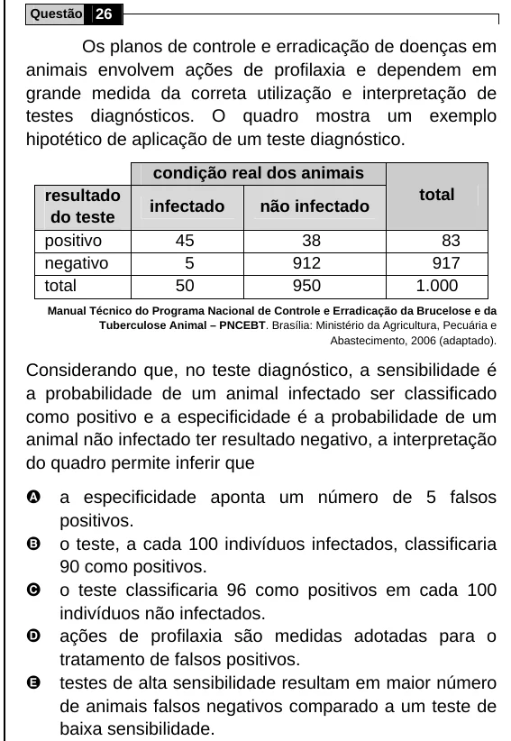

Texto extraído (pode conter ruído)

Questão 26  
Os planos de controle e erradicação de doenças em  
animais envolvem ações de profilaxia e dependem em  
grande medida da correta utilização e interpretação de  
testes diagnósticos. O quadro mostra um exemplo  
hipotético de aplicação de um teste diagnóstico.  
condição real dos animais  
resultado  
total  
infectado  
não infectado  
do teste  
positivo  
45  
38  
83  
negativo  
5  
912  
917  
total  
50  
950  
1.000  
Manual Técnico do Programa Nacional de Controle e Erradicação da Brucelose e da  
Tuberculose Animal – PNCEBT. Brasília: Ministério da Agricultura, Pecuária e  
Abastecimento, 2006 (adaptado).  
Considerando que, no teste diagnóstico, a sensibilidade é  
a probabilidade de um animal infectado ser classificado  
como positivo e a especificidade é a probabilidade de um  
animal não infectado ter resultado negativo, a interpretação  
do quadro permite inferir que  
A  
a especificidade aponta um número de 5 falsos  
positivos.  
B  
o teste, a cada 100 indivíduos infectados, classificaria  
90 como positivos.  
C  
o teste classificaria 96 como positivos em cada 100  
indivíduos não infectados.  
D  
ações de profilaxia são medidas adotadas para o  
tratamento de falsos positivos.  
E  
testes de alta sensibilidade resultam em maior número  
de animais falsos negativos comparado a um teste de  
baixa sensibilidade.

