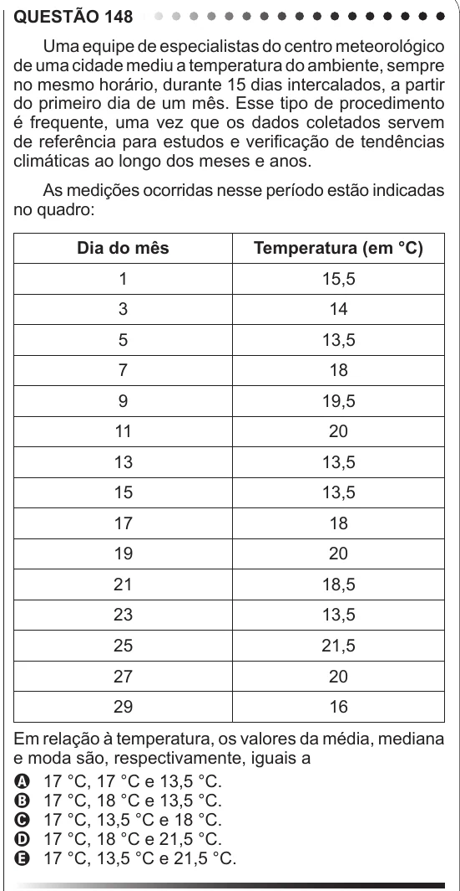

Texto extraído (pode conter ruído)

QUESTÃO 148  
Uma equipe de especialistas do centro meteorológico  
de uma cidade mediu a temperatura do ambiente, sempre  
no mesmo horário, durante 15 dias intercalados, a partir  
do primeiro dia de um mês. Esse tipo de procedimento  
é frequente, uma vez que os dados coletados servem  
de referência para estudos e verificação de tendências  
climáticas ao longo dos meses e anos.  
As medições ocorridas nesse período estão indicadas  
no quadro:  
Dia do mês  
Temperatura (em °C)  
1  
15,5  
3  
14  
5  
13,5  
7  
18  
9  
19,5  
11  
20  
13  
13,5  
15  
13,5  
17  
18  
19  
20  
21  
18,5  
23  
13,5  
25  
21,5  
27  
20  
29  
16  
Em relação à temperatura, os valores da média, mediana  
e moda são, respectivamente, iguais a  
A 17 °C, 17 °C e 13,5 °C.  
B 17 °C, 18 °C e 13,5 °C.  
C 17 °C, 13,5 °C e 18 °C.  
D 17 °C, 18 °C e 21,5 °C.  
E 17 °C, 13,5 °C e 21,5 °C.

