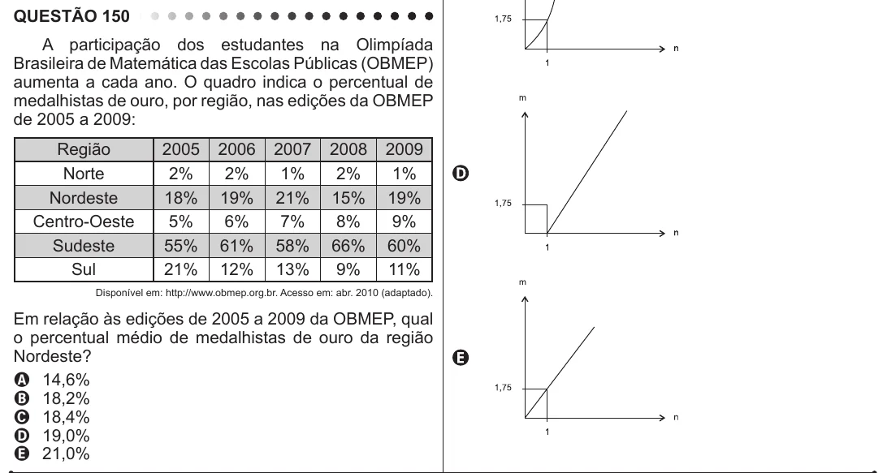

Texto extraído (pode conter ruído)

QUESTÃO 150  
A participação dos estudantes na Olimpíada  
Brasileira de Matemática das Escolas Públicas (OBMEP)  
aumenta a cada ano. O quadro indica o percentual de  
medalhistas de ouro, por região, nas edições da OBMEP  
de 2005 a 2009:  
Região  
2005  
2006  
2007  
2008  
2009  
Norte  
2%  
2%  
1%  
2%  
1%  
Nordeste  
18%  
19%  
21%  
15%  
19%  
Centro-Oeste  
5%  
6%  
7%  
8%  
9%  
Sudeste  
55%  
61%  
58%  
66%  
60%  
Sul  
21%  
12%  
13%  
9%  
11%  
Disponível em: http://www.obmep.org.br. Acesso em: abr. 2010 (adaptado).  
Em relação às edições de 2005 a 2009 da OBMEP, qual  
o percentual médio de medalhistas de ouro da região  
Nordeste?  
A 14,6%  
B 18,2%  
C 18,4%  
D 19,0%  
E 21,0%

