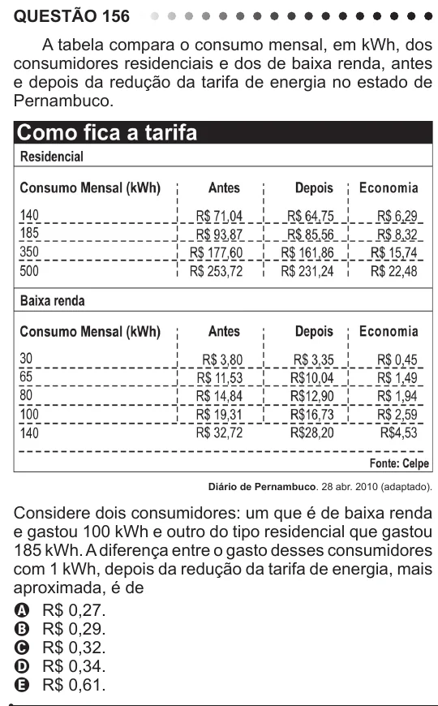

Texto extraído (pode conter ruído)

QUESTÃO 156  
A tabela compara o consumo mensal, em kWh, dos  
consumidores residenciais e dos de baixa renda, antes  
e depois da redução da tarifa de energia no estado de  
Pernambuco.  
Diário de Pernambuco. 28 abr. 2010 (adaptado).  
Considere dois consumidores: um que é de baixa renda  
e gastou 100 kWh e outro do tipo residencial que gastou  
185 kWh. A diferença entre o gasto desses consumidores  
com 1 kWh, depois da redução da tarifa de energia, mais  
aproximada, é de  
A R$ 0,27.  
B R$ 0,29.  
C R$ 0,32.  
D R$ 0,34.  
E R$ 0,61.

