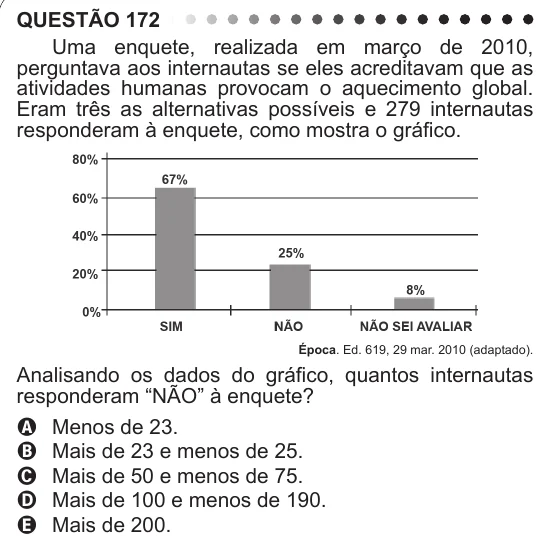

Texto extraído (pode conter ruído)

QUESTÃO 172  
Uma enquete, realizada em março de 2010,  
perguntava aos internautas se eles acreditavam que as  
atividades humanas provocam o aquecimento global.  
Eram três as alternativas possíveis e 279 internautas  
responderam à enquete, como mostra o gráfico.  
Época. Ed. 619, 29 mar. 2010 (adaptado).  
Analisando os dados do gráfico, quantos internautas  
responderam “NÃO” à enquete?  
A Menos de 23.  
B Mais de 23 e menos de 25.  
C Mais de 50 e menos de 75.  
D Mais de 100 e menos de 190.  
E Mais de 200.

