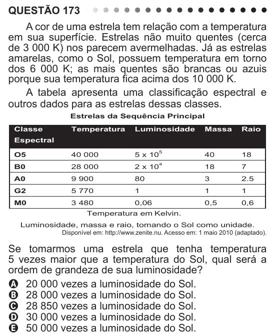

Texto extraído (pode conter ruído)

QUESTÃO 173  
A cor de uma estrela tem relação com a temperatura  
em sua superfície. Estrelas não muito quentes (cerca  
de 3 000 K) nos parecem avermelhadas. Já as estrelas  
amarelas, como o Sol, possuem temperatura em torno  
dos 6 000 K; as mais quentes são brancas ou azuis  
porque sua temperatura fica acima dos 10 000 K.  
A tabela apresenta uma classificação espectral e  
outros dados para as estrelas dessas classes.  
Estrelas da Sequência Principal  
Classe  
Temperatura  
Luminosidade  
Massa  
Raio  
Espectral  
O5  
40 000  
5 x 10 5  
40  
18  
B0  
28 000  
2 x 10 4  
18  
7  
A0  
9 900  
80  
3  
2.5  
G2  
5 770  
1  
1  
1  
M0  
3 480  
0,06  
0,5  
0,6  
Temperatura em Kelvin.  
Luminosidade, massa e raio, tomando o Sol como unidade.  
Disponível em: http://www.zenite.nu. Acesso em: 1 maio 2010 (adaptado).  
Se tomarmos uma estrela que tenha temperatura  
5 vezes maior que a temperatura do Sol, qual será a  
ordem de grandeza de sua luminosidade?  
A 20 000 vezes a luminosidade do Sol.  
B 28 000 vezes a luminosidade do Sol.  
C 28 850 vezes a luminosidade do Sol.  
D 30 000 vezes a luminosidade do Sol.  
E 50 000 vezes a luminosidade do Sol.

