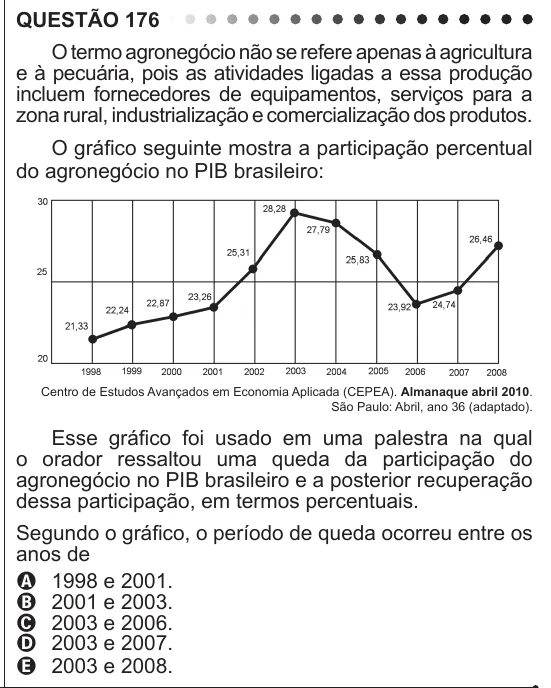

Texto extraído (pode conter ruído)

QUESTÃO 176  
O termo agronegócio não se refere apenas à agricultura  
e à pecuária, pois as atividades ligadas a essa produção  
incluem fornecedores de equipamentos, serviços para a  
zona rural, industrialização e comercialização dos produtos.  
O gráfico seguinte mostra a participação percentual  
do agronegócio no PIB brasileiro:  
Centro de Estudos Avançados em Economia Aplicada (CEPEA). Almanaque abril 2010.  
São Paulo: Abril, ano 36 (adaptado).  
Esse gráfico foi usado em uma palestra na qual  
o orador ressaltou uma queda da participação do  
agronegócio no PIB brasileiro e a posterior recuperação  
dessa participação, em termos percentuais.  
Segundo o gráfico, o período de queda ocorreu entre os  
anos de  
A 1998 e 2001.  
B 2001 e 2003.  
C 2003 e 2006.  
D 2003 e 2007.  
E 2003 e 2008.

