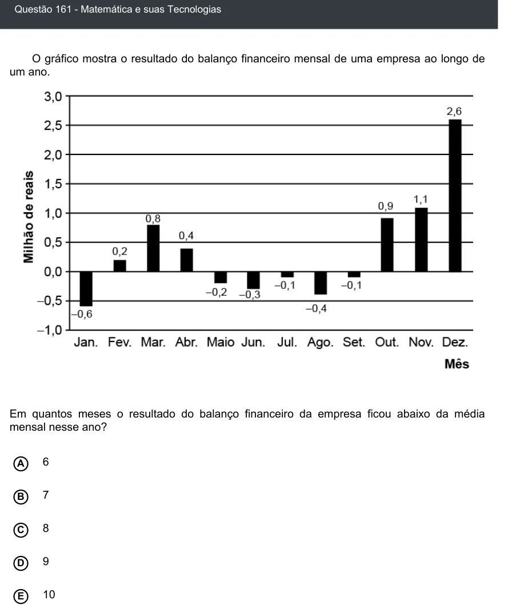

Texto extraído (pode conter ruído)

Questão 161 - Matemática e suas Tecnologias  
O gráfico mostra o resultado do balanço financeiro mensal de uma empresa ao longo de  
um ano.  
Em quantos meses o resultado do balanço financeiro da empresa ficou abaixo da média  
mensal nesse ano?  
A  
6  
7  
B  
8  
C  
9  
D  
E  
10

