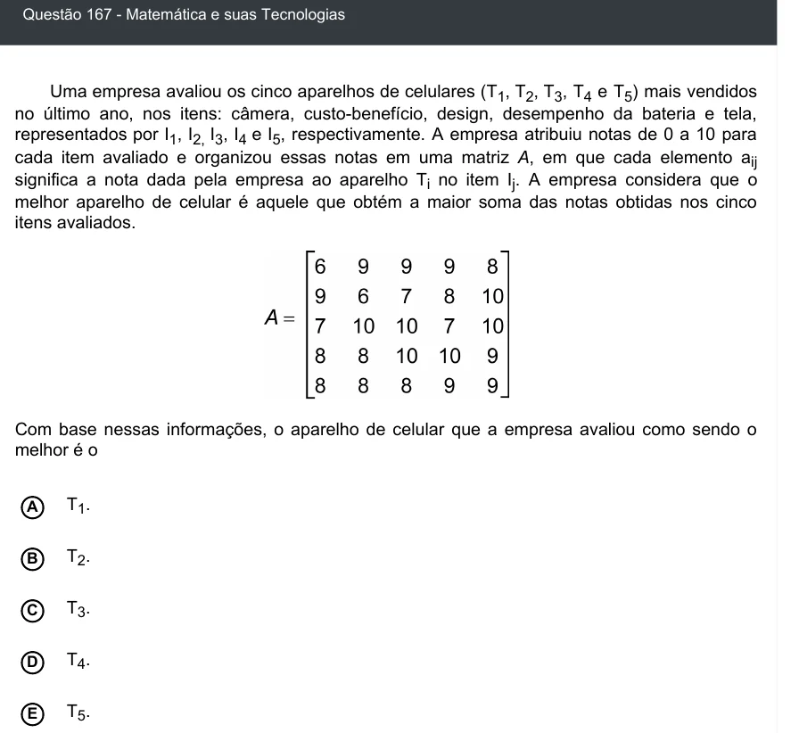

Texto extraído (pode conter ruído)

Questão 167 - Matemática e suas Tecnologias  
Uma empresa avaliou os cinco aparelhos de celulares (T 1 , T 2 , T 3 , T 4 e T 5 ) mais vendidos  
no último ano, nos itens: câmera, custo-benefí cio, design, desempenho da bateria e tela,  
representados por I 1 , I 2, I 3 , I 4 e I 5 , respectivamente. A empresa atribuiu notas de 0 a 10 para  
cada item avaliado e organizou essas notas em uma matriz A, em que cada elemento a ij  
significa a nota dada pela empresa ao aparelho T i no item I j . A empresa considera que o  
melhor aparelho de celular é aquele que obtém a maior soma das notas obtidas nos cinco  
itens avaliados.  
Com base nessas informações, o aparelho de celular que a empresa avaliou como sendo o  
melhor é o  
T 1 .  
A  
T 2 .  
B  
T 3 .  
C  
D  
T 4 .  
T 5 .  
E

