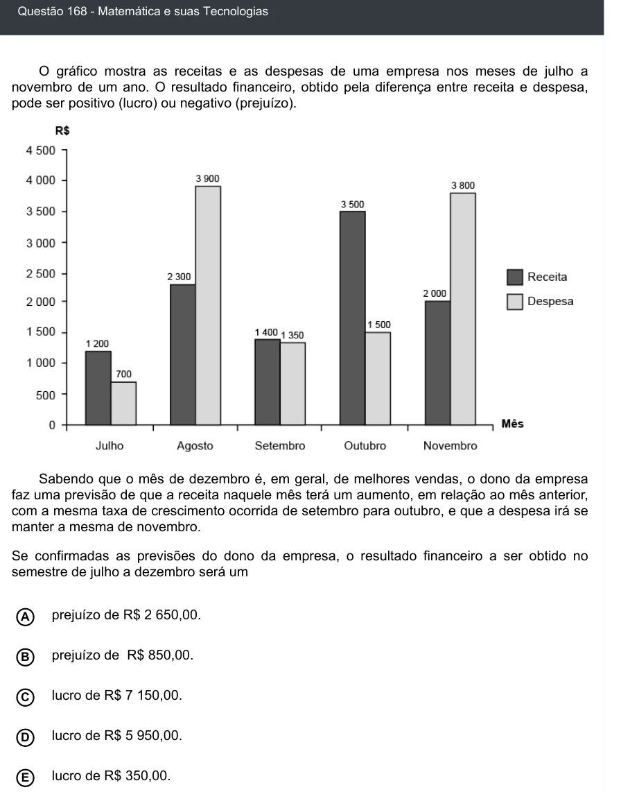

Texto extraído (pode conter ruído)

Questão 168 - Matemática e suas Tecnologias  
O gráfico mostra as receitas e as despesas de uma empresa nos meses de julho a  
novembro de um ano. O resultado financeiro, obtido pela diferença entre receita e despesa,  
pode ser positivo (lucro) ou negativo (prejuízo).  
Sabendo que o mês de dezembro é, em geral, de melhores vendas, o dono da empresa  
faz uma previsão de que a receita naquele mês terá um aumento, em relação ao mês anterior,  
com a mesma taxa de crescimento ocorrida de setembro para outubro, e que a despesa irá se  
manter a mesma de novembro.  
Se confirmadas as previsões do dono da empresa, o resultado financeiro a ser obtido no  
semestre de julho a dezembro será um  
prejuízo de R$ 2 650,00.  
A  
prejuízo de R$ 850,00.  
B  
C  
lucro de R$ 7 150,00.  
lucro de R$ 5 950,00.  
D  
lucro de R$ 350,00.  
E

