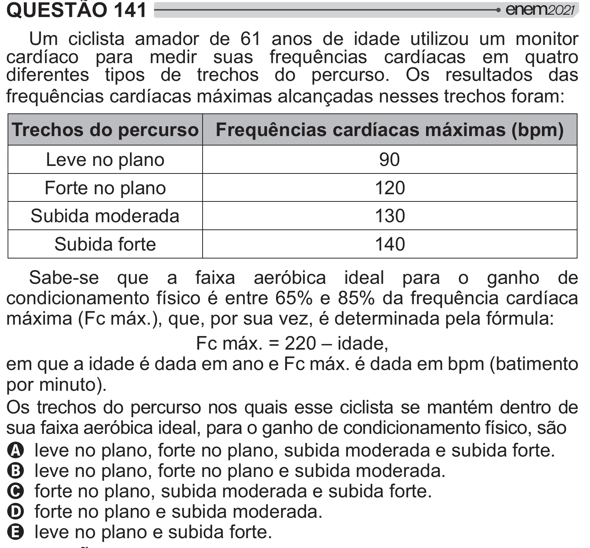

Texto extraído (pode conter ruído)

QUESTÃO 141  
Um ciclista amador de 61 anos de idade utilizou um monitor  
cardíaco para medir suas frequências cardíacas em quatro  
diferentes tipos de trechos do percurso. Os resultados das  
frequências cardíacas máximas alcançadas nesses trechos foram:  
Trechos do percurso Frequências cardíacas máximas (bpm)  
Leve no plano  
90  
Forte no plano  
120  
Subida moderada  
130  
Subida forte  
140  
Sabe-se que a faixa aeróbica ideal para o ganho de  
condicionamento físico é entre 65% e 85% da frequência cardíaca  
máxima (Fc máx.), que, por sua vez, é determinada pela fórmula:  
Fc máx. = 220 – idade,  
em que a idade é dada em ano e Fc máx. é dada em bpm (batimento  
por minuto).  
Os trechos do percurso nos quais esse ciclista se mantém dentro de  
sua faixa aeróbica ideal, para o ganho de condicionamento físico, são  
A leve no plano, forte no plano, subida moderada e subida forte.  
B leve no plano, forte no plano e subida moderada.  
C forte no plano, subida moderada e subida forte.  
D forte no plano e subida moderada.  
E leve no plano e subida forte.

