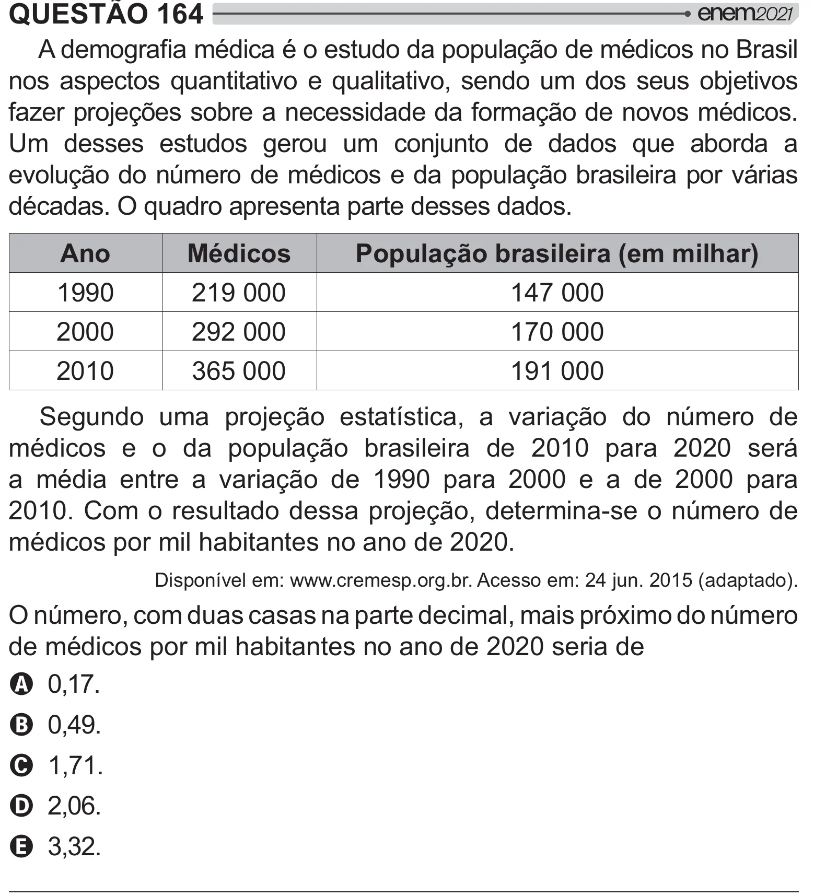

Texto extraído (pode conter ruído)

QUESTÃO 164  
 <<  
## =[ < š   
nos aspectos quantitativo e qualitativo, sendo um dos seus objetivos  
fazer projeções sobre a necessidade da formação de novos médicos.  
Um desses estudos gerou um conjunto de dados que aborda a  
evolução do número de médicos e da população brasileira por várias  
décadas. O quadro apresenta parte desses dados.  
Ano  
Médicos  
População brasileira (em milhar)  
1990  
219 000  
147 000  
2000  
292 000  
170 000  
2010  
365 000  
191 000  
Segundo uma projeção estatística, a variação do número de  
médicos e o da população brasileira de 2010 para 2020 será  
a média entre a variação de 1990 para 2000 e a de 2000 para  
2010. Com o resultado dessa projeção, determina-se o número de  
médicos por mil habitantes no ano de 2020.  
Disponível em: www.cremesp.org.br. Acesso em: 24 jun. 2015 (adaptado).  
O número, com duas casas na parte decimal, mais próximo do número  
de médicos por mil habitantes no ano de 2020 seria de  
A 0,17.  
B 0,49.  
C 1,71.  
D 2,06.  
E 3,32.

