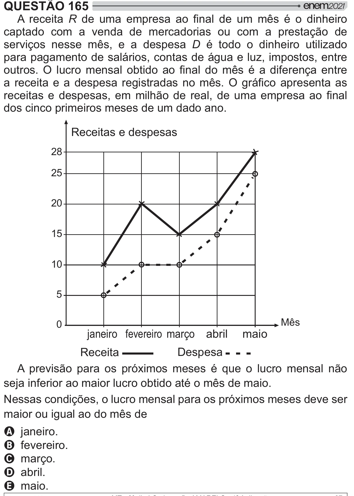

Texto extraído (pode conter ruído)

QUESTÃO 165  
A receita R    #       +  <  $   
captado com a venda de mercadorias ou com a prestação de  
serviços nesse mês, e a despesa D é todo o dinheiro utilizado  
para pagamento de salários, contas de água e luz, impostos, entre  
  !       y     +  <  >  =     
        #       + !  / #  
     
       #    $[        #     
dos cinco primeiros meses de um dado ano.  
Receitas e despesas  
28  
25  
20  
15  
10  
5  
Mês  
0  
janeiro fevereiro março abril  
maio  
Despesa  
Receita  
A previsão para os próximos meses é que o lucro mensal não  
seja inferior ao maior lucro obtido até o mês de maio.  
Nessas condições, o lucro mensal para os próximos meses deve ser  
maior ou igual ao do mês de  
A janeiro.  
B fevereiro.  
C março.  
D abril.  
E maio.

