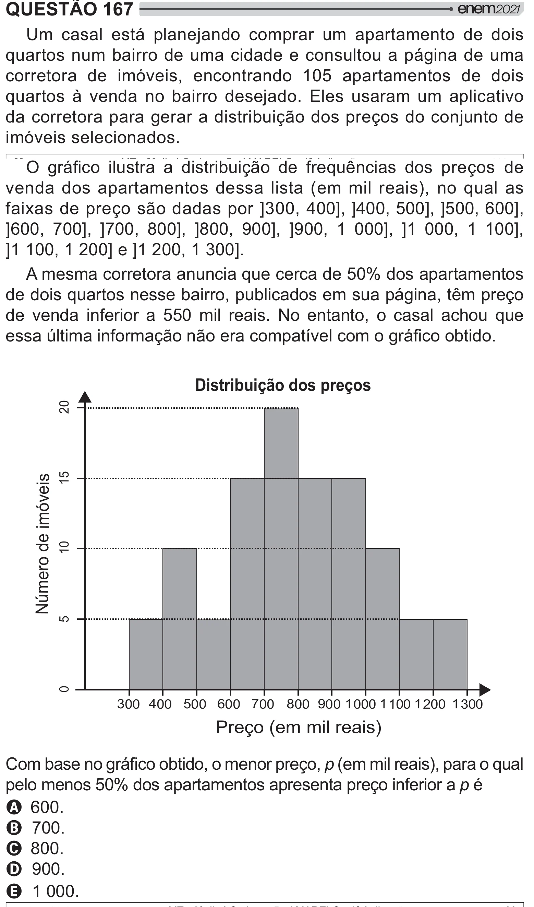

Texto extraído (pode conter ruído)

QUESTÃO 167  
Um casal está planejando comprar um apartamento de dois  
quartos num bairro de uma cidade e consultou a página de uma  
corretora de imóveis, encontrando 105 apartamentos de dois  
quartos à venda no bairro desejado. Eles usaram um aplicativo  
da corretora para gerar a distribuição dos preços do conjunto de  
imóveis selecionados.  
 /     y =[   >  
+    # =     
venda dos apartamentos dessa lista (em mil reais), no qual as  
faixas de preço são dadas por ]300, 400], ]400, 500], ]500, 600],  
]600, 700], ]700, 800], ]800, 900], ]900, 1 000], ]1 000, 1 100],  
]1 100, 1 200] e ]1 200, 1 300].  
A mesma corretora anuncia que cerca de 50% dos apartamentos  
de dois quartos nesse bairro, publicados em sua página, têm preço  
de venda inferior a 550 mil reais. No entanto, o casal achou que  
„ >=[[ # {" /y !  
Distribuição dos preços  
20  
15  
Número de imóveis  
10  
5  
0  
300 400 500 600 700 800 900 1 000 1 100 1 200 1 300  
Preço (em mil reais)  
y /y  # =p (em mil reais), para o qual  
pelo menos 50% dos apartamentos apresenta preço inferior a p é  
A 600.  
B 700.  
C 800.  
D 900.  
E 1 000.

