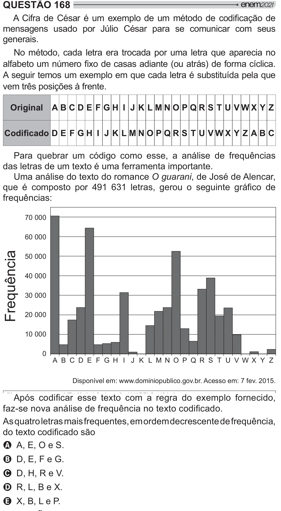

Texto extraído (pode conter ruído)

QUESTÃO 168  
 >   <  <  * #    <    =[    
mensagens usado por Júlio César para se comunicar com seus  
generais.  
No método, cada letra era trocada por uma letra que aparecia no  
>y  „ *    J  / W >{!  
A seguir temos um exemplo em que cada letra é substituída pela que  
vem três posições à frente.  
Original  
A B C D E F GH I J K L MNO P QR S T U VWX Y Z  
  D E F G H I J K L M N O P Q R S T U V W X Y Z A B C  
Para quebrar um código como esse, a análise de frequências  
das letras de um texto é uma ferramenta importante.  
Uma análise do texto do romance O guarani, de José de Alencar,  
 < #  # ¨` ©®`           /    
frequências:  
70 000  
60 000  
Frequência  
50 000  
40 000  
30 000  
20 000  
10 000  
0  
A B C D E F G H I J K L M N O P Q R S T U V W X Y Z  
Disponível em: www.dominiopublico.gov.br. Acesso em: 7 fev. 2015.  
A#ƒ    
 *       * # >   
> "/  >  
+ * !  
      >  
        >  
+  
 *  [  
A  !  
B %À ^!  
C %’ –!  
D ?š Â!  
E š? !

