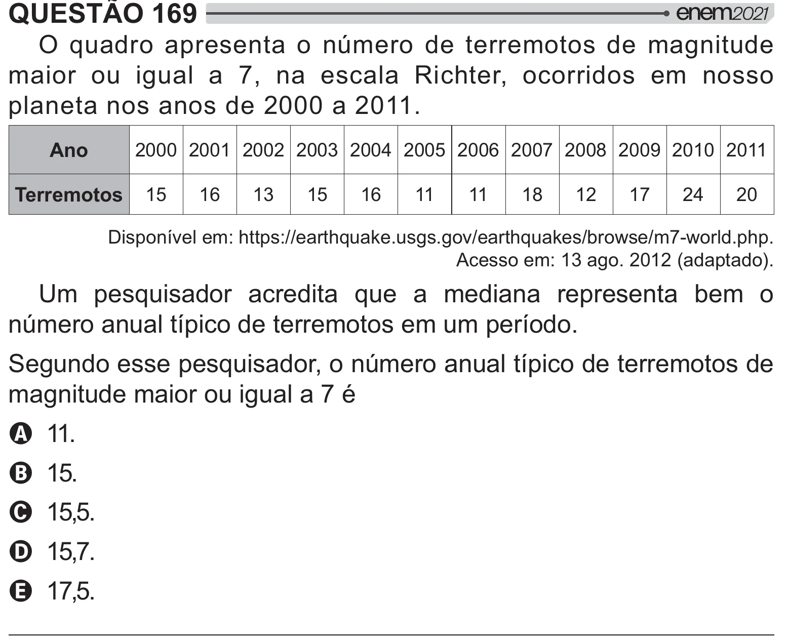

Texto extraído (pode conter ruído)

QUESTÃO 169  
  #  
   „              
      Ä   $        
#    ‘___‘_``!  
Ano  
‘___ ‘__` ‘__‘ ‘__® ‘__ ‘__ ‘__© ‘__Ä ‘__£ ‘__¨ ‘_`_ ‘_``  
Terremotos  
`  
`©  
`®  
`  
`©  
``  
``  
`£  
`‘  
`Ä  
‘  
‘_  
% #{"  œ$ # œBB  $  
‚ !  
 !"B  $ ‚ ByŒ BČ!#$#!  
  
 œ`®!‘_`‘J# W!  
' #  
      
     #  
  y    
„   {#       # {!  
    
#  
 „   {#        
    Ä<  
A``!  
B`!  
C`!  
D`Ä!  
E`Ä!

