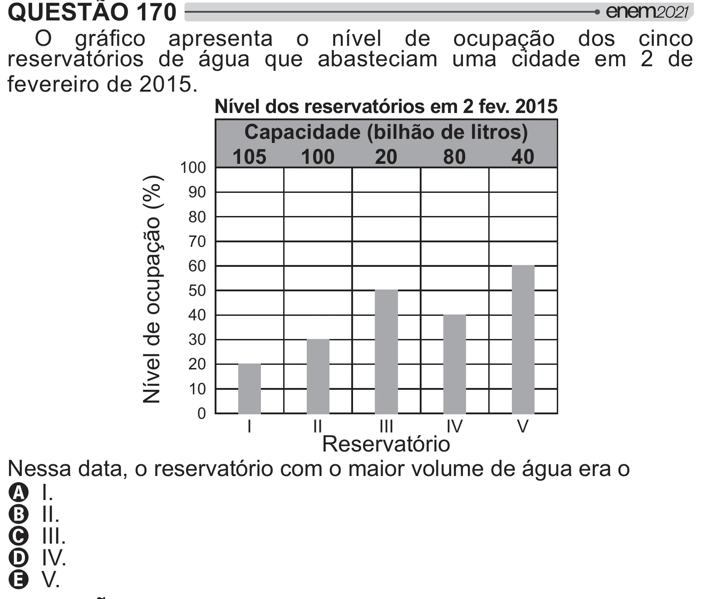

Texto extraído (pode conter ruído)

QUESTÃO 170  
 / #  
   {"     #=[     
reservatórios de água que abasteciam uma cidade em 2 de  
fevereiro de 2015.  
Nível dos reservatórios em 2 fev. 2015  
Capacidade (bilhão de litros)  
105  
100  
20  
80  
40  
100  
Nível de ocupação (%)  
90  
80  
70  
60  
50  
40  
30  
20  
10  
0  
I  
II  
III  
IV  
V  
Reservatório  
Nessa data, o reservatório com o maior volume de água era o  
A I.  
B II.  
C III.  
D IV.  
E V.

