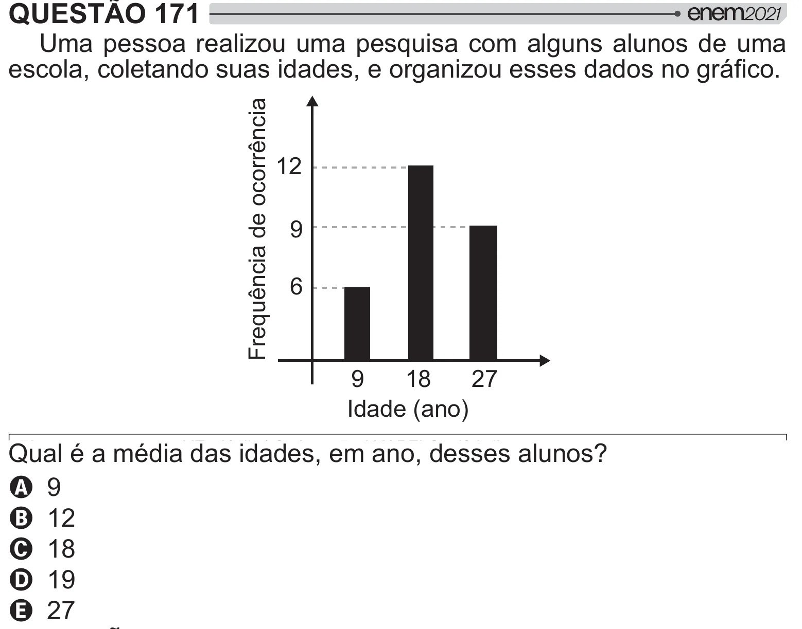

Texto extraído (pode conter ruído)

QUESTÃO 171  
Uma pessoa realizou uma pesquisa com alguns alunos de uma  
        
 /!  
Frequência de ocorrência  
12  
9  
6  
9  
18  
27  
Idade (ano)  
& <<   
   
  ]  
A ¨  
B `‘  
C `£  
D `¨  
E ‘Ä

