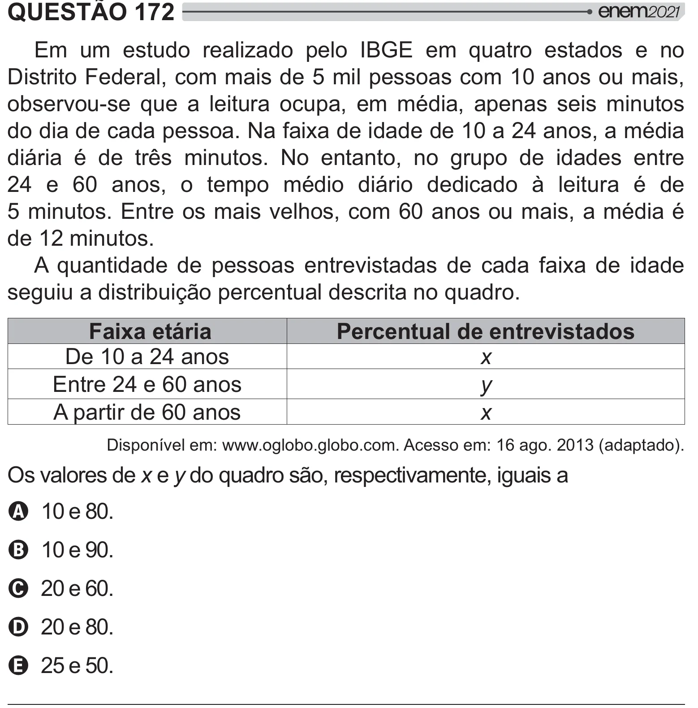

Texto extraído (pode conter ruído)

QUESTÃO 172  
   
   #  Kš^     
     
%  À    #  
 `_     
y "    
      #  < #         
 #  
!ˆ>*   `_‘ <  
/ <   +    ! ˆ      #         
‘  ©_    # < /   ¸    <    
  !    " $ ©_   <<  
 `‘  !  
      #  
    "      >*      
   y =[#      !  
Faixa etária  
Percentual de entrevistados  
% `_‘  
x  
  ‘ ©_  
y  
#  ©_  
x  
% #{"  œŒŒŒ!y!y!!  
 œ`©!‘_`®J# W!  
 "  x y  
 [ #  "      
A `_ £_!  
B `_ ¨_!  
C ‘_ ©_!  
D ‘_ £_!  
E ‘ _!

