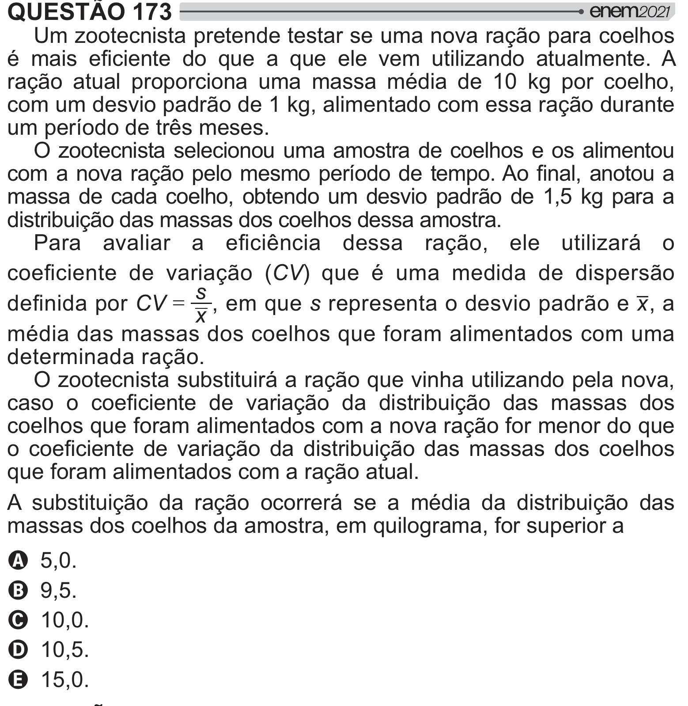

Texto extraído (pode conter ruído)

QUESTÃO 173  
Um zootecnista pretende testar se uma nova ração para coelhos  
<        
   
   "      !   
ração atual proporciona uma massa média de 10 kg por coelho,  
com um desvio padrão de 1 kg, alimentado com essa ração durante  
um período de três meses.  
O zootecnista selecionou uma amostra de coelhos e os alimentou  
"=[#  # {  #!    
massa de cada coelho, obtendo um desvio padrão de 1,5 kg para a  
distribuição das massas dos coelhos dessa amostra.  
 "  +   
 =[    
/   
      "=[ JCV) que é uma medida de dispersão  
s  
, em que s representa o desvio padrão e x , a  
 #CV  
x  
média das massas dos coelhos que foram alimentados com uma  
determinada ração.  
O zootecnista substituirá a ração que vinha utilizando pela nova,  
         "=[   y =[         
coelhos que foram alimentados com a nova ração for menor do que  
       "=[   y =[         $   
que foram alimentados com a ração atual.  
A substituição da ração ocorrerá se a média da distribuição das  
massas dos coelhos da amostra, em quilograma, for superior a  
A 5,0.  
B 9,5.  
C 10,0.  
D 10,5.  
E 15,0.

