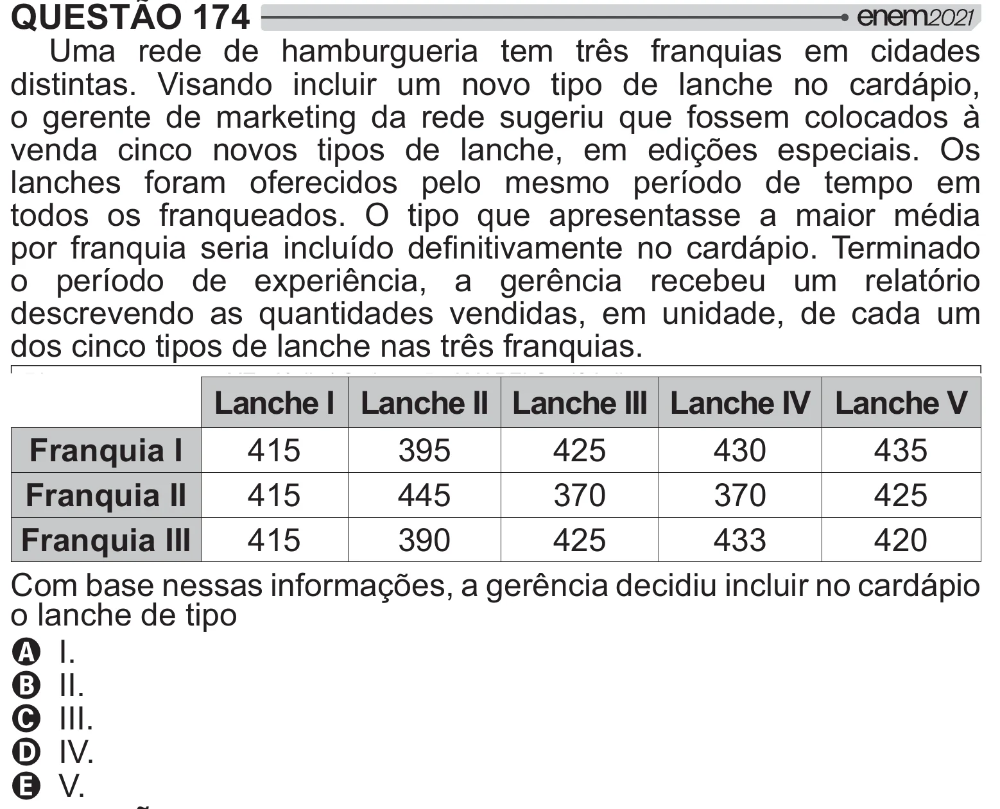

Texto extraído (pode conter ruído)

QUESTÃO 174  
Uma rede de hamburgueria tem três franquias em cidades  
distintas. Visando incluir um novo tipo de lanche no cardápio,  
o gerente de marketing da rede sugeriu que fossem colocados à  
venda cinco novos tipos de lanche, em edições especiais. Os  
lanches foram oferecidos pelo mesmo período de tempo em  
todos os franqueados. O tipo que apresentasse a maior média  
# >    {   "    /#!    
o período de experiência, a gerência recebeu um relatório  
descrevendo as quantidades vendidas, em unidade, de cada um  
dos cinco tipos de lanche nas três franquias.  
Lanche I Lanche II Lanche III Lanche IV Lanche V  
Franquia I  
415  
395  
425  
430  
435  
Franquia II  
415  
445  
370  
370  
425  
Franquia III  
415  
390  
425  
433  
420  
Com base nessas informações, a gerência decidiu incluir no cardápio  
o lanche de tipo  
A I.  
B II.  
C III.  
D IV.  
E V.

