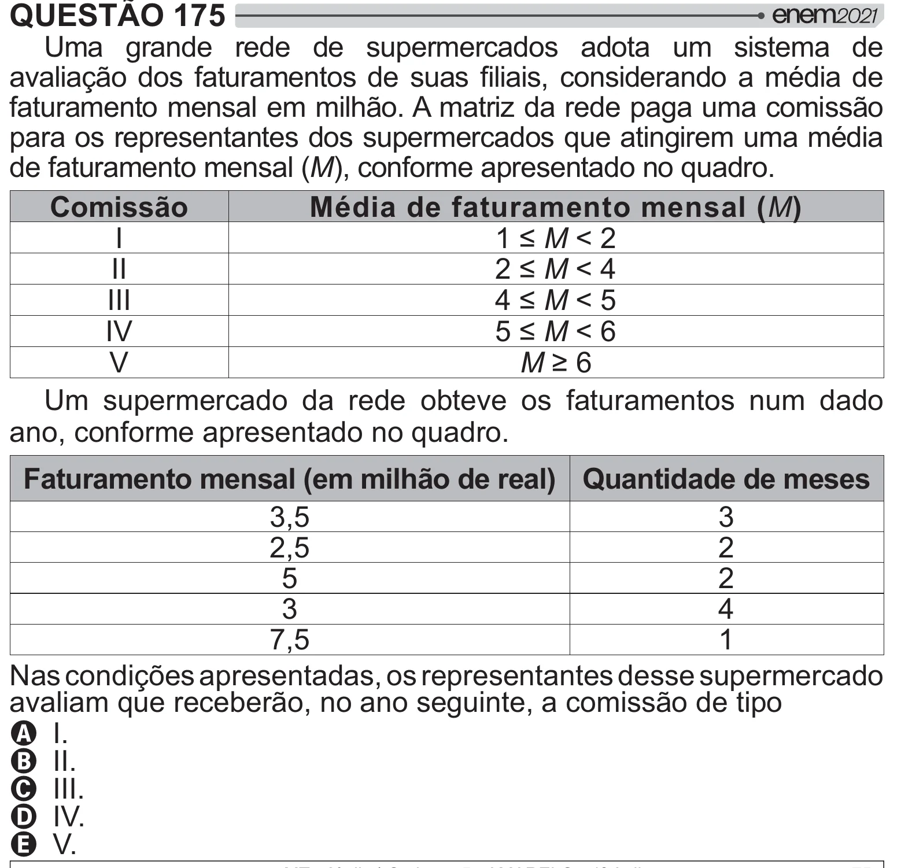

Texto extraído (pode conter ruído)

QUESTÃO 175  
Uma grande rede de supermercados adota um sistema de  
"=[   >               <    
faturamento mensal em milhão. A matriz da rede paga uma comissão  
para os representantes dos supermercados que atingirem uma média  
de faturamento mensal (M), conforme apresentado no quadro.  
Comissão  
Média de faturamento mensal (M)  
I  
`ÅM < 2  
II  
‘ÅM < 4  
III  
ÅM < 5  
IV  
ÅM < 6  
V  
MÈ©  
Um supermercado da rede obteve os faturamentos num dado  
ano, conforme apresentado no quadro.  
Faturamento mensal (em milhão de real) Quantidade de meses  
3,5  
3  
2,5  
2  
5  
2  
3  
4  
7,5  
1  
Nas condições apresentadas, os representantes desse supermercado  
avaliam que receberão, no ano seguinte, a comissão de tipo  
A I.  
B II.  
C III.  
D IV.  
E V.

