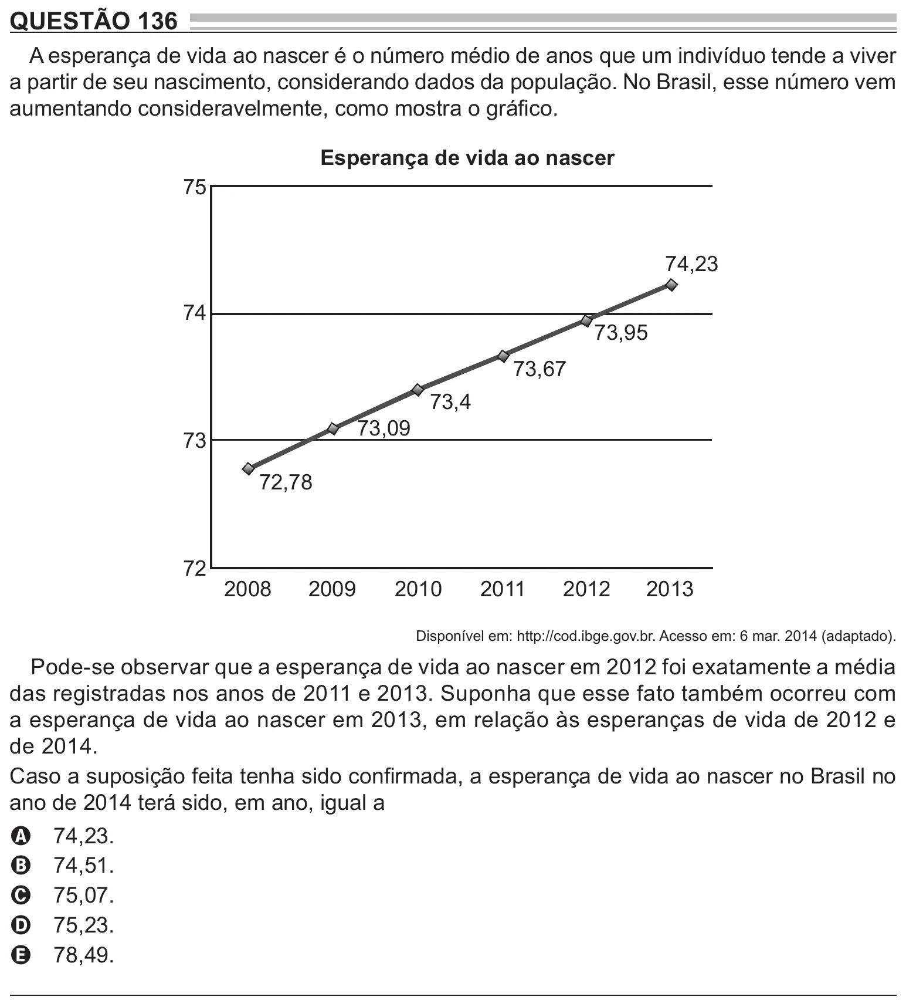

Texto extraído (pode conter ruído)

QUESTÃO 136  
A esperança de vida ao nascer é o número médio de anos que um indivíduo tende a viver  
a partir de seu nascimento, considerando dados da população. No Brasil, esse número vem  
aumentando consideravelmente, como mostra o gráfico.  
Esperança de vida ao nascer  
75  
74,23  
74  
73,95  
73,67  
73,4  
73,09  
73  
72,78  
72  
2008  
2009  
2010  
2011  
2012  
2013  
Disponível em: http://cod.ibge.gov.br. Acesso em: 6 mar. 2014 (adaptado).  
Pode-se observar que a esperança de vida ao nascer em 2012 foi exatamente a média  
das registradas nos anos de 2011 e 2013. Suponha que esse fato também ocorreu com  
a esperança de vida ao nascer em 2013, em relação às esperanças de vida de 2012 e  
de 2014.  
Caso a suposição feita tenha sido confirmada, a esperança de vida ao nascer no Brasil no  
ano de 2014 terá sido, em ano, igual a  
74,23.  
A  
74,51.  
B  
75,07.  
C  
75,23.  
D  
78,49.  
E

