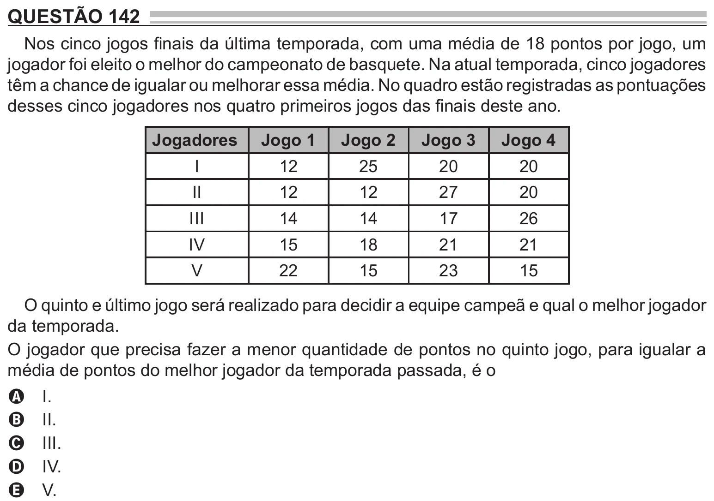

Texto extraído (pode conter ruído)

QUESTÃO 142  
Nos cinco jogos finais da última temporada, com uma média de 18 pontos por jogo, um  
jogador foi eleito o melhor do campeonato de basquete. Na atual temporada, cinco jogadores  
têm a chance de igualar ou melhorar essa média. No quadro estão registradas as pontuações  
desses cinco jogadores nos quatro primeiros jogos das finais deste ano.  
Jogadores  
Jogo 1  
Jogo 2  
Jogo 3  
Jogo 4  
I  
12  
25  
20  
20  
II  
12  
12  
27  
20  
III  
14  
14  
17  
26  
IV  
15  
18  
21  
21  
V  
22  
15  
23  
15  
O quinto e último jogo será realizado para decidir a equipe campeã e qual o melhor jogador  
da temporada.  
O jogador que precisa fazer a menor quantidade de pontos no quinto jogo, para igualar a  
média de pontos do melhor jogador da temporada passada, é o  
I.  
A  
II.  
B  
III.  
C  
IV.  
D  
V.  
E

