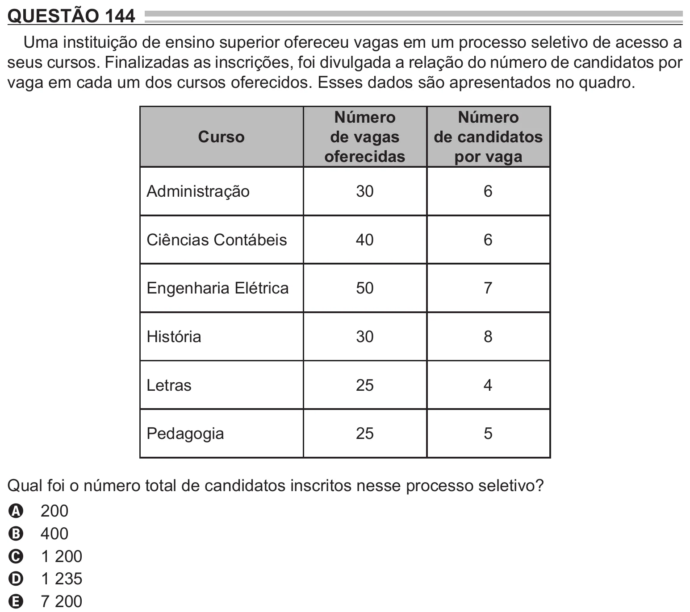

Texto extraído (pode conter ruído)

QUESTÃO 144  
Uma instituição de ensino superior ofereceu vagas em um processo seletivo de acesso a  
seus cursos. Finalizadas as inscrições, foi divulgada a relação do número de candidatos por  
vaga em cada um dos cursos oferecidos. Esses dados são apresentados no quadro.  
Número  
Número  
Curso  
de vagas  
de candidatos  
oferecidas  
por vaga  
Administração  
30  
6  
Ciências Contábeis  
40  
6  
Engenharia Elétrica  
50  
7  
História  
30  
8  
Letras  
25  
4  
Pedagogia  
25  
5  
Qual foi o número total de candidatos inscritos nesse processo seletivo?  
200  
A  
400  
B  
1 200  
C  
1 235  
D  
7 200  
E

