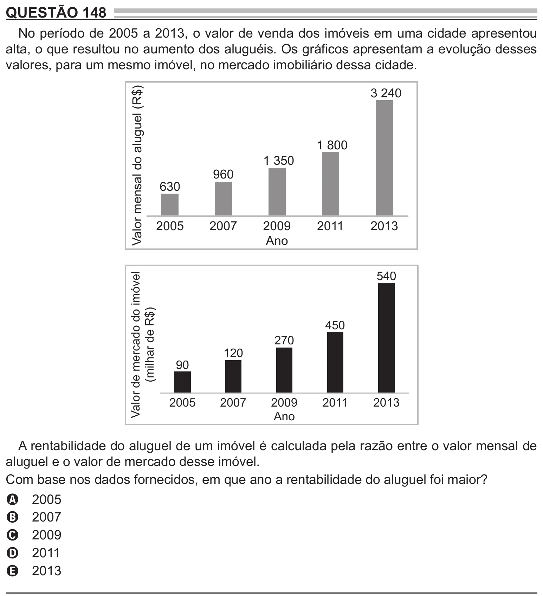

Texto extraído (pode conter ruído)

QUESTÃO 148  
No período de 2005 a 2013, o valor de venda dos imóveis em uma cidade apresentou  
alta, o que resultou no aumento dos aluguéis. Os gráficos apresentam a evolução desses  
valores, para um mesmo imóvel, no mercado imobiliário dessa cidade.  
Valor mensal do aluguel (R$)  
3 240  
1 800  
1 350  
960  
630  
2005  
2007  
2009  
2011  
2013  
Ano  
540  
Valor de mercado do imóvel  
(milhar de R$)  
450  
270  
120  
90  
2005  
2007  
2009  
2011  
2013  
Ano  
A rentabilidade do aluguel de um imóvel é calculada pela razão entre o valor mensal de  
aluguel e o valor de mercado desse imóvel.  
Com base nos dados fornecidos, em que ano a rentabilidade do aluguel foi maior?  
2005  
A  
2007  
B  
2009  
C  
2011  
D  
2013  
E

