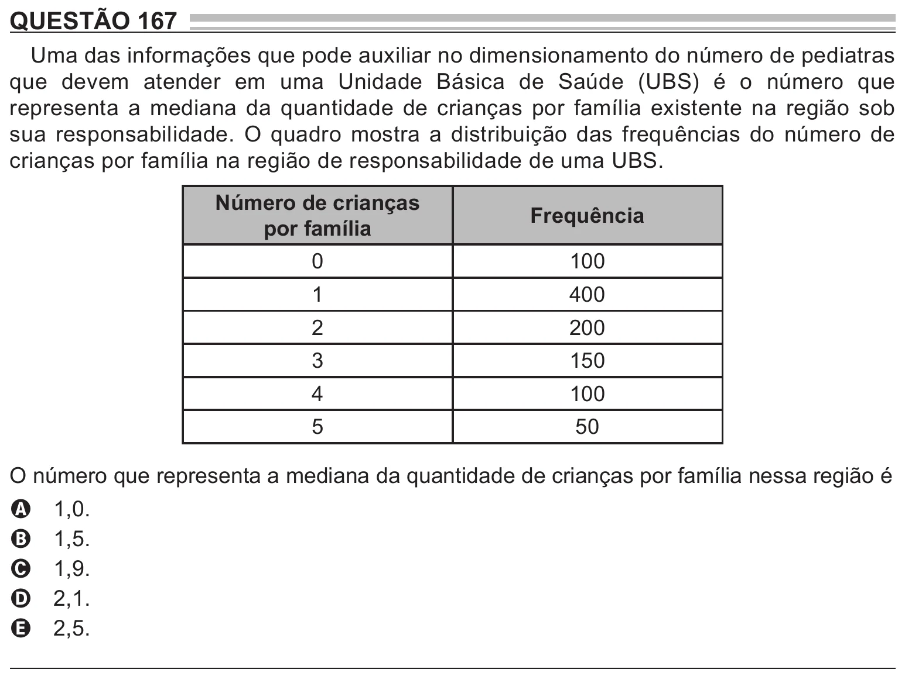

Texto extraído (pode conter ruído)

QUESTÃO 167  
Uma das informações que pode auxiliar no dimensionamento do número de pediatras  
que devem atender em uma Unidade Básica de Saúde (UBS) é o número que  
representa a mediana da quantidade de crianças por família existente na região sob  
sua responsabilidade. O quadro mostra a distribuição das frequências do número de  
crianças por família na região de responsabilidade de uma UBS.  
Número de crianças  
Frequência  
por família  
0  
100  
1  
400  
2  
200  
3  
150  
4  
100  
5  
50  
O número que representa a mediana da quantidade de crianças por família nessa região é  
1,0.  
A  
1,5.  
B  
1,9.  
C  
2,1.  
D  
2,5.  
E

