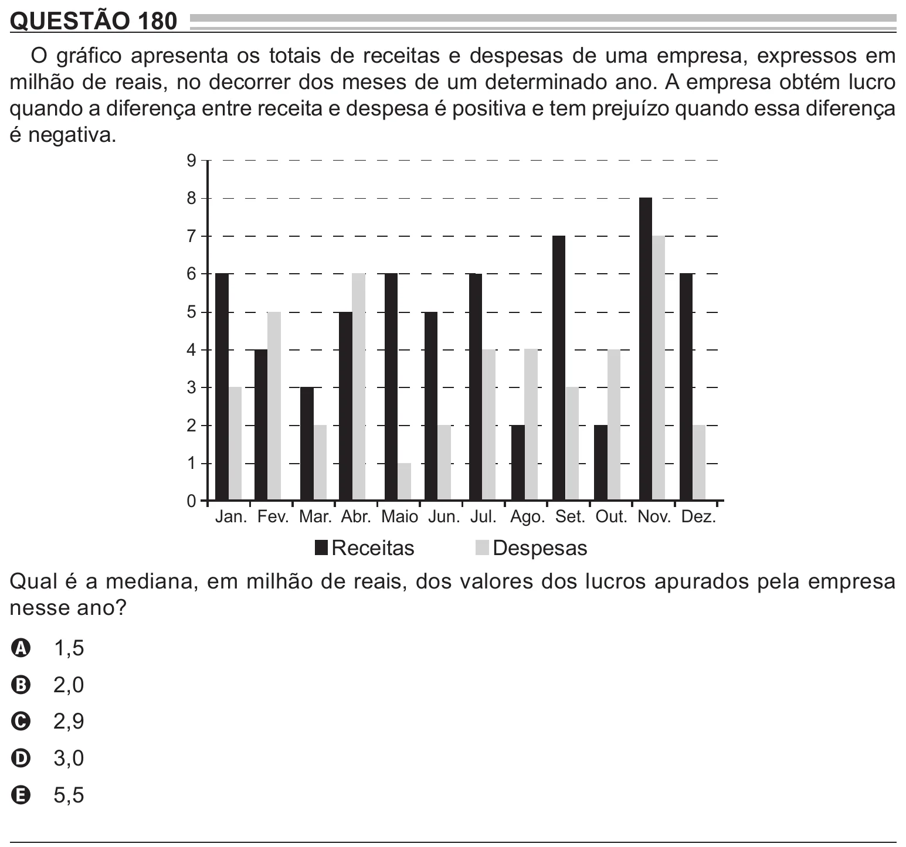

Texto extraído (pode conter ruído)

QUESTÃO 180  
O gráfico apresenta os totais de receitas e despesas de uma empresa, expressos em  
milhão de reais, no decorrer dos meses de um determinado ano. A empresa obtém lucro  
quando a diferença entre receita e despesa é positiva e tem prejuízo quando essa diferença  
é negativa.  
9  
8  
7  
6  
5  
4  
3  
2  
1  
0  
Jan. Fev. Mar. Abr. Maio Jun. Jul. Ago. Set. Out. Nov. Dez.  
Receitas  
Despesas  
Qual é a mediana, em milhão de reais, dos valores dos lucros apurados pela empresa  
nesse ano?  
1,5  
A  
2,0  
B  
2,9  
C  
3,0  
D  
5,5  
E

