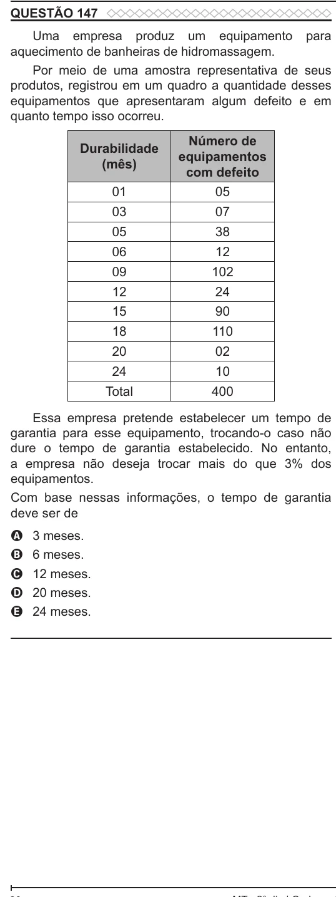

Texto extraído (pode conter ruído)

QUESTÃO 147  
Uma empresa produz um equipamento para  
aquecimento de banheiras de hidromassagem.  
Por meio de uma amostra representativa de seus  
produtos, registrou em um quadro a quantidade desses  
equipamentos que apresentaram algum defeito e em  
quanto tempo isso ocorreu.  
Número de  
Durabilidade  
equipamentos  
(mês)  
com defeito  
01  
05  
03  
07  
05  
38  
06  
12  
09  
102  
12  
24  
15  
90  
18  
110  
20  
02  
24  
10  
Total  
400  
Essa empresa pretende estabelecer um tempo de  
garantia para esse equipamento, trocando-o caso não  
dure o tempo de garantia estabelecido. No entanto,  
a empresa não deseja trocar mais do que 3% dos  
equipamentos.  
Com base nessas informações, o tempo de garantia  
deve ser de  
3 meses.  
A  
6 meses.  
B  
12 meses.  
C  
D  
20 meses.  
24 meses.  
E

