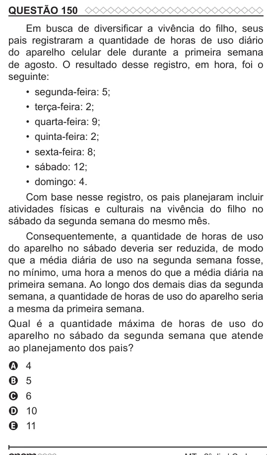

Texto extraído (pode conter ruído)

QUESTÃO 150  
Em busca de diversificar a vivência do filho, seus  
pais registraram a quantidade de horas de uso diário  
do aparelho celular dele durante a primeira semana  
de agosto. O resultado desse registro, em hora, foi o  
seguinte:  
• segunda-feira: 5;  
• terça-feira: 2;  
• quarta-feira: 9;  
• quinta-feira: 2;  
• sexta-feira: 8;  
• sábado: 12;  
• domingo: 4.  
Com base nesse registro, os pais planejaram incluir  
atividades físicas e culturais na vivência do filho no  
sábado da segunda semana do mesmo mês.  
Consequentemente, a quantidade de horas de uso  
do aparelho no sábado deveria ser reduzida, de modo  
que a média diária de uso na segunda semana fosse,  
no mínimo, uma hora a menos do que a média diária na  
primeira semana. Ao longo dos demais dias da segunda  
semana, a quantidade de horas de uso do aparelho seria  
a mesma da primeira semana.  
Qual é a quantidade máxima de horas de uso do  
aparelho no sábado da segunda semana que atende  
ao planejamento dos pais?  
4  
A  
B  
5  
6  
C  
10  
D  
11  
E

