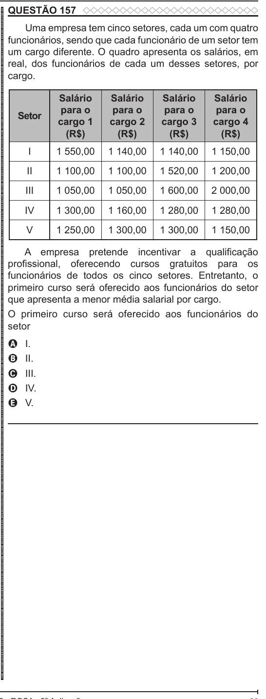

Texto extraído (pode conter ruído)

QUESTÃO 157  
ENEM 2022 ENEM 2022 ENEM 2022 ENEM 2022 ENEM 2022 ENEM 2022 ENEM 2022 ENEM 2022 ENEM 2022 ENEM 2022 ENEM 2022 ENEM 2022 ENEM 2022 ENEM 2022 ENEM 2022 ENEM 2022 ENEM 2022 ENEM 2022 ENEM 2022 ENEM 2022 ENEM 2022 ENEM 2022 ENEM 2022 ENEM 2022 ENEM 2022 ENEM 2022 ENEM 2022 ENEM 2022 ENEM 2022 ENEM 2022 ENEM 2022 ENEM 2022 ENEM 2022 ENEM 2022 ENEM 2022 ENEM 2022 ENEM 2022 ENEM 2022 ENEM 2022 ENEM 2022 ENEM 2022 ENEM 2022 ENEM 2022 ENEM 2022 ENEM 2022 ENEM 2022 ENEM 2022 ENEM 2022 ENEM 2022 ENEM 2022 ENEM 2022 ENEM 2022 ENEM 2022 ENEM 2022 ENEM 2022 ENEM 2022 ENEM 2022 ENEM 2022 ENEM 2022 ENEM 2022 ENEM 2022 ENEM 2022 ENEM 2022  
Uma empresa tem cinco setores, cada um com quatro  
funcionários, sendo que cada funcionário de um setor tem  
um cargo diferente. O quadro apresenta os salários, em  
real, dos funcionários de cada um desses setores, por  
cargo.  
Salário  
Salário  
Salário  
Salário  
para o  
para o  
para o  
para o  
Setor  
cargo 1  
cargo 2  
cargo 3  
cargo 4  
(R$)  
(R$)  
(R$)  
(R$)  
I  
1 550,00  
1 140,00  
1 140,00  
1 150,00  
II  
1 100,00  
1 100,00  
1 520,00  
1 200,00  
III  
1 050,00  
1 050,00  
1 600,00  
2 000,00  
IV  
1 300,00  
1 160,00  
1 280,00  
1 280,00  
V  
1 250,00  
1 300,00  
1 300,00  
1 150,00  
A empresa pretende incentivar a qualificação  
profissional, oferecendo cursos gratuitos para os  
funcionários de todos os cinco setores. Entretanto, o  
primeiro curso será oferecido aos funcionários do setor  
que apresenta a menor média salarial por cargo.  
O primeiro curso será oferecido aos funcionários do  
setor  
I.  
A  
II.  
B  
C  
III.  
IV.  
D  
V.  
E

