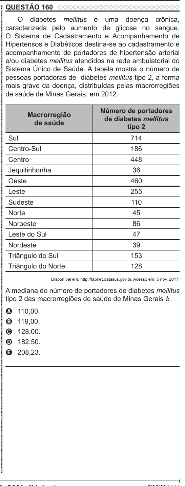

Texto extraído (pode conter ruído)

QUESTÃO 160  
ENEM 2022 ENEM 2022 ENEM 2022 ENEM 2022 ENEM 2022 ENEM 2022 ENEM 2022 ENEM 2022 ENEM 2022 ENEM 2022 ENEM 2022 ENEM 2022 ENEM 2022 ENEM 2022 ENEM 2022 ENEM 2022 ENEM 2022 ENEM 2022 ENEM 2022 ENEM 2022 ENEM 2022 ENEM 2022 ENEM 2022 ENEM 2022 ENEM 2022 ENEM 2022 ENEM 2022 ENEM 2022 ENEM 2022 ENEM 2022 ENEM 2022 ENEM 2022 ENEM 2022 ENEM 2022 ENEM 2022 ENEM 2022 ENEM 2022 ENEM 2022 ENEM 2022 ENEM 2022 ENEM 2022 ENEM 2022 ENEM 2022 ENEM 2022 ENEM 2022 ENEM 2022 ENEM 2022 ENEM 2022 ENEM 2022 ENEM 2022 ENEM 2022 ENEM 2022 ENEM 2022 ENEM 2022 ENEM 2022 ENEM 2022 ENEM 2022 ENEM 2022 ENEM 2022 ENEM 2022 ENEM 2022 ENEM 2022 ENEM 2022  
O diabetes mellitus é uma doença crônica,  
caracterizada pelo aumento de glicose no sangue.  
O Sistema de Cadastramento e Acompanhamento de  
Hipertensos e Diabéticos destina-se ao cadastramento e  
acompanhamento de portadores de hipertensão arterial  
e/ou diabetes mellitus atendidos na rede ambulatorial do  
Sistema Único de Saúde. A tabela mostra o número de  
pessoas portadoras de diabetes mellitus tipo 2, a forma  
mais grave da doença, distribuídas pelas macrorregiões  
de saúde de Minas Gerais, em 2012.  
Número de portadores  
Macrorregião  
de diabetes mellitus  
de saúde  
tipo 2  
Sul  
714  
Centro-Sul  
186  
Centro  
448  
Jequitinhonha  
36  
Oeste  
460  
Leste  
255  
Sudeste  
110  
Norte  
45  
Noroeste  
86  
Leste do Sul  
47  
Nordeste  
39  
Triângulo do Sul  
153  
Triângulo do Norte  
128  
Disponível em: http://tabnet.datasus.gov.br. Acesso em: 5 nov. 2017.  
A mediana do número de portadores de diabetes mellitus  
tipo 2 das macrorregiões de saúde de Minas Gerais é  
110,00.  
A  
119,00.  
B  
C  
128,00.  
182,50.  
D  
208,23.  
E

