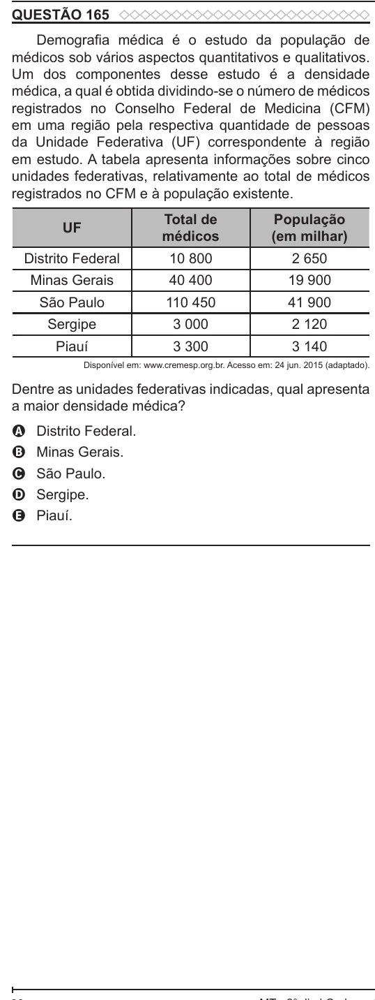

Texto extraído (pode conter ruído)

QUESTÃO 165  
Demografia médica é o estudo da população de  
médicos sob vários aspectos quantitativos e qualitativos.  
Um dos componentes desse estudo é a densidade  
médica, a qual é obtida dividindo-se o número de médicos  
registrados no Conselho Federal de Medicina (CFM)  
em uma região pela respectiva quantidade de pessoas  
da Unidade Federativa (UF) correspondente à região  
em estudo. A tabela apresenta informações sobre cinco  
unidades federativas, relativamente ao total de médicos  
registrados no CFM e à população existente.  
Total de  
População  
UF  
médicos  
(em milhar)  
Distrito Federal  
10 800  
2 650  
Minas Gerais  
40 400  
19 900  
São Paulo  
110 450  
41 900  
Sergipe  
3 000  
2 120  
Piauí  
3 300  
3 140  
Disponível em: www.cremesp.org.br. Acesso em: 24 jun. 2015 (adaptado).  
Dentre as unidades federativas indicadas, qual apresenta  
a maior densidade médica?  
Distrito Federal.  
A  
Minas Gerais.  
B  
São Paulo.  
C  
D  
Sergipe.  
Piauí.  
E

