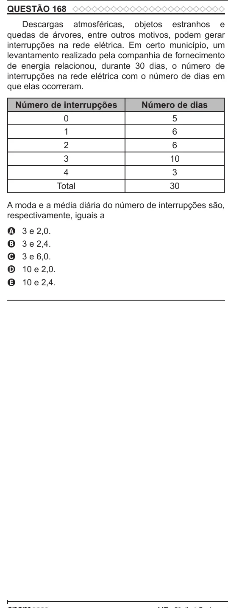

Texto extraído (pode conter ruído)

QUESTÃO 168  
Descargas atmosféricas, objetos estranhos e  
quedas de árvores, entre outros motivos, podem gerar  
interrupções na rede elétrica. Em certo município, um  
levantamento realizado pela companhia de fornecimento  
de energia relacionou, durante 30 dias, o número de  
interrupções na rede elétrica com o número de dias em  
que elas ocorreram.  
Número de interrupções  
Número de dias  
0  
5  
1  
6  
2  
6  
3  
10  
4  
3  
Total  
30  
A moda e a média diária do número de interrupções são,  
respectivamente, iguais a  
3 e 2,0.  
A  
3 e 2,4.  
B  
3 e 6,0.  
C  
10 e 2,0.  
D  
E  
10 e 2,4.

