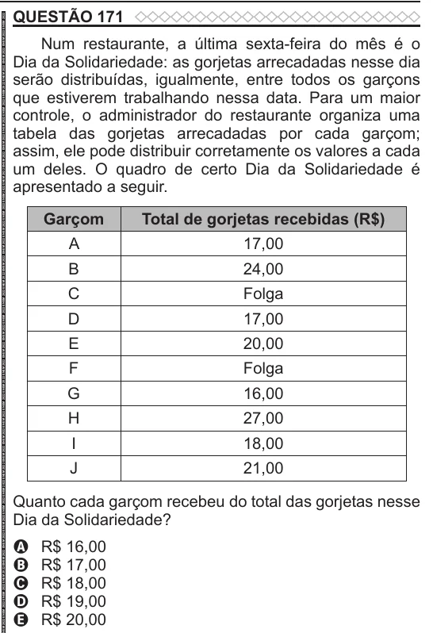

Texto extraído (pode conter ruído)

QUESTÃO 171  
Num restaurante, a última sexta-feira do mês é o  
Dia da Solidariedade: as gorjetas arrecadadas nesse dia  
serão distribuídas, igualmente, entre todos os garçons  
que estiverem trabalhando nessa data. Para um maior  
controle, o administrador do restaurante organiza uma  
tabela das gorjetas arrecadadas por cada garçom;  
assim, ele pode distribuir corretamente os valores a cada  
um deles. O quadro de certo Dia da Solidariedade é  
apresentado a seguir.  
Garçom  
Total de gorjetas recebidas (R$)  
A  
17,00  
B  
24,00  
C  
Folga  
D  
17,00  
E  
20,00  
F  
Folga  
G  
16,00  
H  
27,00  
I  
18,00  
J  
21,00  
Quanto cada garçom recebeu do total das gorjetas nesse  
Dia da Solidariedade?  
A  
R$ 16,00  
R$ 17,00  
B  
R$ 18,00  
C  
D  
R$ 19,00  
R$ 20,00  
E

