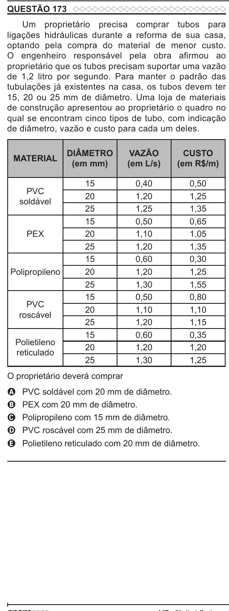

Texto extraído (pode conter ruído)

QUESTÃO 173  
Um proprietário precisa comprar tubos para  
ligações hidráulicas durante a reforma de sua casa,  
optando pela compra do material de menor custo.  
O engenheiro responsável pela obra afirmou ao  
proprietário que os tubos precisam suportar uma vazão  
de 1,2 litro por segundo. Para manter o padrão das  
tubulações já existentes na casa, os tubos devem ter  
15, 20 ou 25 mm de diâmetro. Uma loja de materiais  
de construção apresentou ao proprietário o quadro no  
qual se encontram cinco tipos de tubo, com indicação  
de diâmetro, vazão e custo para cada um deles.  
DIÂMETRO  
VAZÃO  
CUSTO  
MATERIAL  
(em mm)  
(em L/s)  
(em R$/m)  
15  
0,40  
0,50  
PVC  
20  
1,20  
1,25  
soldável  
25  
1,25  
1,35  
15  
0,50  
0,65  
PEX  
20  
1,10  
1,05  
25  
1,20  
1,35  
15  
0,60  
0,30  
Polipropileno  
20  
1,20  
1,25  
25  
1,30  
1,55  
15  
0,50  
0,80  
PVC  
20  
1,10  
1,10  
roscável  
25  
1,20  
1,15  
15  
0,60  
0,35  
Polietileno  
20  
1,20  
1,20  
reticulado  
25  
1,30  
1,25  
O proprietário deverá comprar  
PVC soldável com 20 mm de diâmetro.  
A  
PEX com 20 mm de diâmetro.  
B  
Polipropileno com 15 mm de diâmetro.  
C  
D  
PVC roscável com 25 mm de diâmetro.  
Polietileno reticulado com 20 mm de diâmetro.  
E

