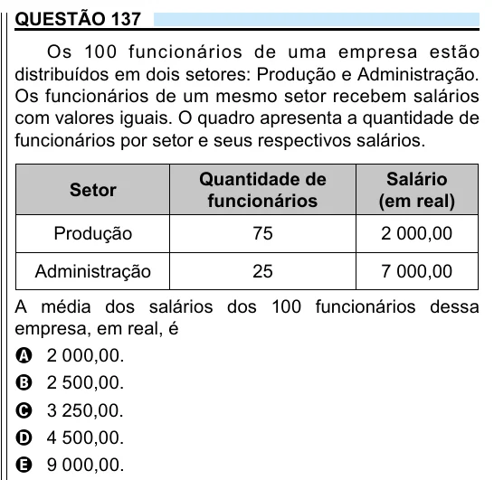

Texto extraído (pode conter ruído)

QUESTÃO 137  
Os 100 funcionários de uma empresa estão  
distribuídos em dois setores: Produção e Administração.  
Os funcionários de um mesmo setor recebem salários  
com valores iguais. O quadro apresenta a quantidade de  
funcionários por setor e seus respectivos salários.  
Quantidade de  
Salário  
Setor  
funcionários  
(em real)  
Produção  
75  
2 000,00  
Administração  
25  
7 000,00  
A média dos salários dos 100 funcionários dessa  
empresa, em real, é  
A 2 000,00.  
B 2 500,00.  
C 3 250,00.  
D 4 500,00.  
E 9 000,00.

