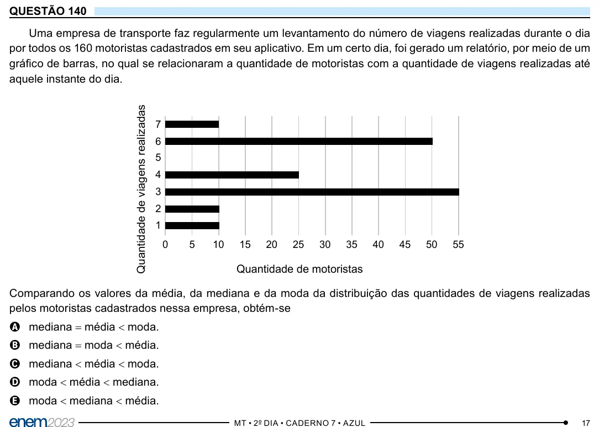

Texto extraído (pode conter ruído)

QUESTÃO 140  
Uma empresa de transporte faz regularmente um levantamento do número de viagens realizadas durante o dia  
por todos os 160 motoristas cadastrados em seu aplicativo. Em um certo dia, foi gerado um relatório, por meio de um  
gráfico de barras, no qual se relacionaram a quantidade de motoristas com a quantidade de viagens realizadas até  
aquele instante do dia.  
Quantidade de viagens realizadas  
7  
6  
5  
4  
3  
2  
1  
0  
5  
10  
15  
20  
25  
30  
35  
40  
45  
50  
55  
Quantidade de motoristas  
Comparando os valores da média, da mediana e da moda da distribuição das quantidades de viagens realizadas  
pelos motoristas cadastrados nessa empresa, obtém-se  
A mediana = média < moda.  
B mediana = moda < média.  
C mediana < média < moda.  
D moda < média < mediana.  
E moda < mediana < média.

