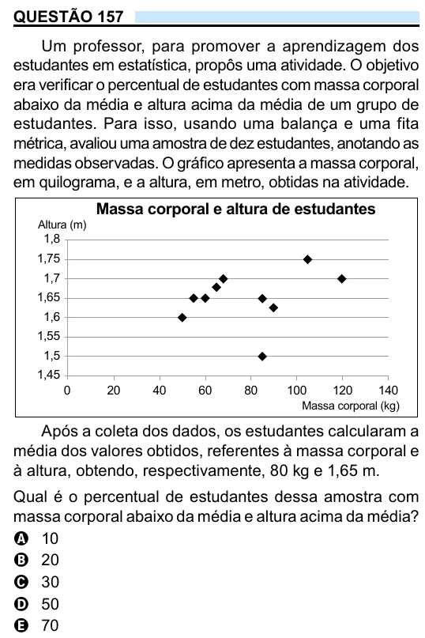

Texto extraído (pode conter ruído)

QUESTÃO 157  
Um professor, para promover a aprendizagem dos  
estudantes em estatística, propôs uma atividade. O objetivo  
era verificar o percentual de estudantes com massa corporal  
abaixo da média e altura acima da média de um grupo de  
estudantes. Para isso, usando uma balança e uma fita  
métrica, avaliou uma amostra de dez estudantes, anotando as  
medidas observadas. O gráfico apresenta a massa corporal,  
em quilograma, e a altura, em metro, obtidas na atividade.  
Massa corporal e altura de estudantes  
Altura (m)  
1,8  
1,75  
1,7  
1,65  
1,6  
1,55  
1,5  
1,45  
0  
20  
40  
60  
80  
100  
120  
140  
Massa corporal (kg)  
Após a coleta dos dados, os estudantes calcularam a  
média dos valores obtidos, referentes à massa corporal e  
à altura, obtendo, respectivamente, 80 kg e 1,65 m.  
Qual é o percentual de estudantes dessa amostra com  
massa corporal abaixo da média e altura acima da média?  
A 10  
B 20  
C 30  
D 50  
E 70

