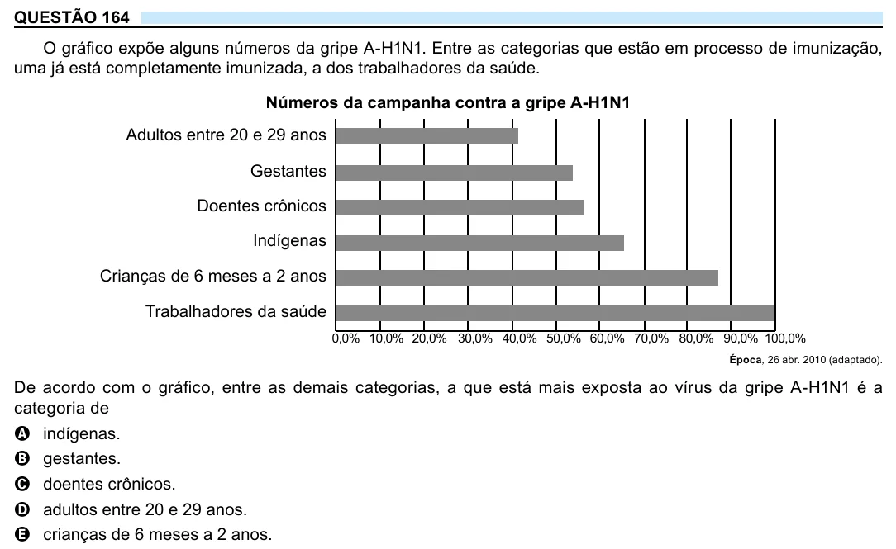

Texto extraído (pode conter ruído)

QUESTÃO 164  
O gráfico expõe alguns números da gripe A-H1N1. Entre as categorias que estão em processo de imunização,  
uma já está completamente imunizada, a dos trabalhadores da saúde.  
Números da campanha contra a gripe A-H1N1  
Adultos entre 20 e 29 anos  
Gestantes  
Doentes crônicos  
Indígenas  
Crianças de 6 meses a 2 anos  
Trabalhadores da saúde  
0,0% 10,0% 20,0% 30,0% 40,0% 50,0% 60,0% 70,0% 80,0% 90,0% 100,0%  
Época, 26 abr. 2010 (adaptado).  
De acordo com o gráfico, entre as demais categorias, a que está mais exposta ao vírus da gripe A-H1N1 é a  
categoria de  
A indígenas.  
B gestantes.  
C doentes crônicos.  
D adultos entre 20 e 29 anos.  
E crianças de 6 meses a 2 anos.

