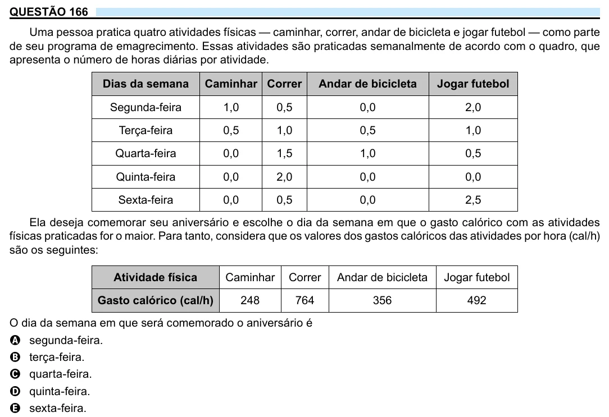

Texto extraído (pode conter ruído)

QUESTÃO 166  
Uma pessoa pratica quatro atividades físicas — caminhar, correr, andar de bicicleta e jogar futebol — como parte  
de seu programa de emagrecimento. Essas atividades são praticadas semanalmente de acordo com o quadro, que  
apresenta o número de horas diárias por atividade.  
Dias da semana  
Caminhar Correr  
Andar de bicicleta  
Jogar futebol  
Segunda-feira  
1,0  
0,5  
0,0  
2,0  
Terça-feira  
0,5  
1,0  
0,5  
1,0  
Quarta-feira  
0,0  
1,5  
1,0  
0,5  
Quinta-feira  
0,0  
2,0  
0,0  
0,0  
Sexta-feira  
0,0  
0,5  
0,0  
2,5  
Ela deseja comemorar seu aniversário e escolhe o dia da semana em que o gasto calórico com as atividades  
físicas praticadas for o maior. Para tanto, considera que os valores dos gastos calóricos das atividades por hora (cal/h)  
são os seguintes:  
Atividade física  
Caminhar  
Correr  
Andar de bicicleta  
Jogar futebol  
Gasto calórico (cal/h)  
248  
764  
356  
492  
O dia da semana em que será comemorado o aniversário é  
A segunda-feira.  
B terça-feira.  
C quarta-feira.  
D quinta-feira.  
E sexta-feira.

