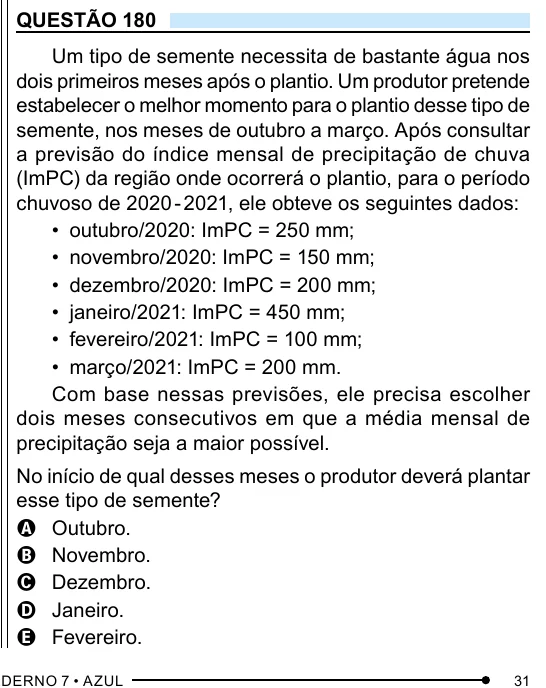

Texto extraído (pode conter ruído)

QUESTÃO 180  
Um tipo de semente necessita de bastante água nos  
dois primeiros meses após o plantio. Um produtor pretende  
estabelecer o melhor momento para o plantio desse tipo de  
semente, nos meses de outubro a março. Após consultar  
a previsão do índice mensal de precipitação de chuva  
(ImPC) da região onde ocorrerá o plantio, para o período  
chuvoso de 2020 - 2021, ele obteve os seguintes dados:  
• outubro/2020: ImPC = 250 mm;  
• novembro/2020: ImPC = 150 mm;  
• dezembro/2020: ImPC = 200 mm;  
• janeiro/2021: ImPC = 450 mm;  
• fevereiro/2021: ImPC = 100 mm;  
• março/2021: ImPC = 200 mm.  
Com base nessas previsões, ele precisa escolher  
dois meses consecutivos em que a média mensal de  
precipitação seja a maior possível.  
No início de qual desses meses o produtor deverá plantar  
esse tipo de semente?  
A Outubro.  
B Novembro.  
C Dezembro.  
D Janeiro.  
E Fevereiro.

