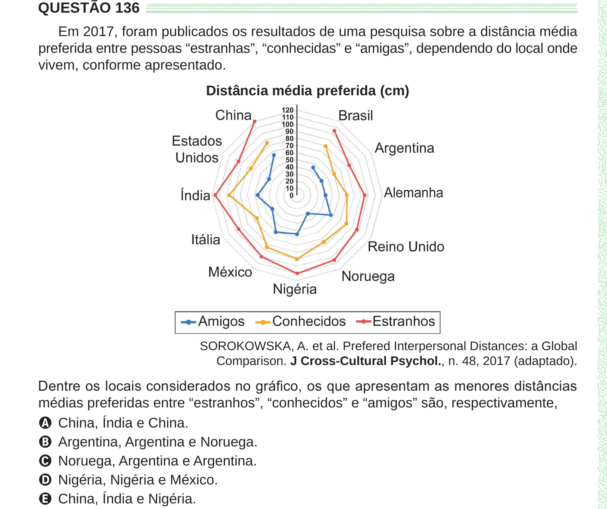

Texto extraído (pode conter ruído)

QUESTÃO 136  
Em 2017, foram publicados os resultados de uma pesquisa sobre a distância média  
preferida entre pessoas “estranhas”, “conhecidas” e “amigas”, dependendo do local onde  
vivem, conforme apresentado.  
Distância média preferida (cm)  
SOROKOWSKA, A. et al. Prefered Interpersonal Distances: a Global  
Comparison. J Cross-Cultural Psychol., n. 48, 2017 (adaptado).  
Dentre os locais considerados no gráfico, os que apresentam as menores distâncias  
médias preferidas entre “estranhos”, “conhecidos” e “amigos” são, respectivamente,  
A China, Índia e China.  
B Argentina, Argentina e Noruega.  
C Noruega, Argentina e Argentina.  
D Nigéria, Nigéria e México.  
E China, Índia e Nigéria.

