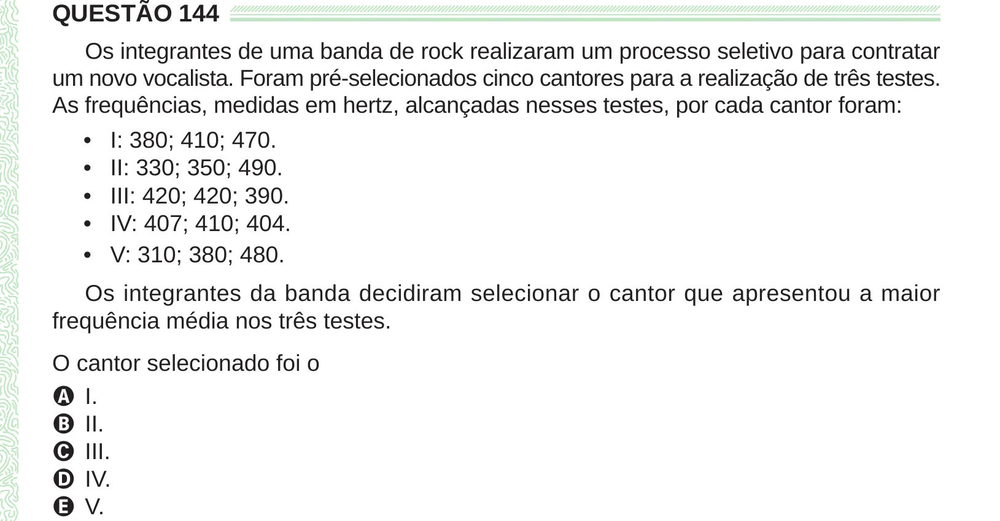

Texto extraído (pode conter ruído)

QUESTÃO 144  
Os integrantes de uma banda de rock realizaram um processo seletivo para contratar  
um novo vocalista. Foram pré-selecionados cinco cantores para a realização de três testes.  
As frequências, medidas em hertz, alcançadas nesses testes, por cada cantor foram:  
•  
I: 380; 410; 470.  
•  
II: 330; 350; 490.  
•  
III: 420; 420; 390.  
•  
IV: 407; 410; 404.  
•  
V: 310; 380; 480.  
Os integrantes da banda decidiram selecionar o cantor que apresentou a maior  
frequência média nos três testes.  
O cantor selecionado foi o  
A I.  
B II.  
C III.  
D IV.  
E V.

